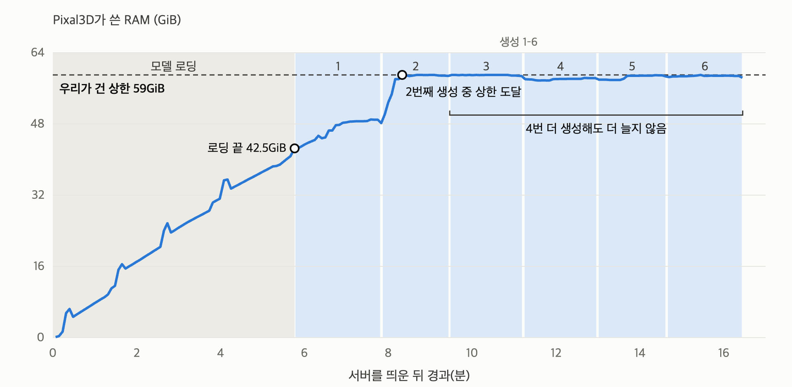

[English](README.md) · [한국어](README.ko.md) · [中文](README.zh-cn.md)

# image-to-3d-pixal3d

그림 한 장을 넣으면 텍스처가 입혀진 3D 모델(GLB)을 만들어 주는 서비스다.

Tencent ARC의 Pixal3D를 model-compose로 띄워 RTX 4090(24GB)에서 실행했다. 이 모델이 내 기기에서 돌아가는지, 돌아가면 무엇을 잘하고 못하는지를 봤고, 다른 모델과는 비교하지 않았다. Mac(Apple M2)에서는 공식 코드가 돌지 않아 제3자 8비트 이식판으로 그림 한 장만 돌려 봤다. DGX Spark(GB10, 통합 메모리 128GB)에서는 CUDA 툴킷과 Triton을 맞춘 뒤 공식 코드가 돌았고, 입력 5개로 속도와 메모리를 쟀다.

입력은 명화다. 미술관이 퍼블릭 도메인으로 공개한 그림 9점에서 의자, 구두, 꽃병, 해골 같은 물건 11개를 잘라 넣었다. 질문은 하나로 모인다. **화가가 그리지 않은 뒷면을 모델은 어떻게 채우는가.** Pixal3D는 입력 그림의 시점을 그대로 지켜 3D를 만든다는 점을 내세우는데, 그림에서는 이 성질이 화가의 붓 터치와 원근 왜곡까지 형태로 옮기는 쪽으로 나타났다.

결과는 네 각도(정면, 3/4, 옆, 뒤)로 렌더한 그림을 VLM이 보고 초안을 쓰고 작성자 1인이 확정했다.


그림 1: 고흐 〈고흐의 방〉(1889)의 의자(왼쪽)로 만든 3D. 정면(가운데)은 그림과 겹치지만 옆(오른쪽)에서 보면 의자가 크게 기울어 있다. 그림의 비뚤어진 원근이 형태로 옮겨졌다.


데모: 의자 그림을 웹 UI(gradio)에 올려 3D를 만들고 마우스로 끌어 한 바퀴 돌렸다. RTX 4090에서 생성에 약 3분 걸렸다. 생성 대기는 60배, 회전은 10배 빠르게 줄였다(녹화한 Mac 화면의 렌더링이 느렸다).

## 목차

- [모델](#모델)
- [빠른 시작](#빠른-시작)
- [요약](#요약)
- [1 실험 환경](#1-실험-환경)
- [2 내 기기에서 돌아가는가](#2-내-기기에서-돌아가는가)
  - [16GB Mac에서는 8비트 이식판으로 돌아간다](#16gb-mac에서는-8비트-이식판으로-돌아간다)
  - [DGX Spark에서는 CUDA 툴킷과 Triton을 맞춰야 돌아간다](#dgx-spark에서는-cuda-툴킷과-triton을-맞춰야-돌아간다)
- [3 기능별 결과](#3-기능별-결과)
  - [3.1 그림 한 장 → 3D](#31-그림-한-장--3d)
  - [3.2 그림의 시점 그대로](#32-그림의-시점-그대로)
  - [3.3 그려지지 않은 뒷면](#33-그려지지-않은-뒷면)
  - [3.4 배경 자동 제거](#34-배경-자동-제거)
  - [3.5 잘리거나 가려진 물건, 얼굴](#35-잘리거나-가려진-물건-얼굴)
- [4 권고](#4-권고)
- [5 한계와 측정하지 않은 것](#5-한계와-측정하지-않은-것)
- [라이선스](#라이선스)

## 모델

[`TencentARC/Pixal3D`](https://huggingface.co/TencentARC/Pixal3D)는 이미지 한 장에서 텍스처(PBR)가 입혀진 3D 메시를 만드는 모델이다(SIGGRAPH 2026, [논문](https://arxiv.org/abs/2605.10922)). 저장소 가중치는 46GB이고 멀티뷰용 체크포인트가 함께 들어 있다.
다른 이미지→3D 모델은 물체를 정해진 기본 자세로 만들고 입력 그림을 조건으로만 쓰지만, Pixal3D는 그림의 픽셀을 3D 공간으로 되돌려 쌓는다. 그래서 결과가 입력 그림의 시점 그대로 놓이고, 정면에서 보면 그림과 겹친다. 공식 자료는 이것을 "재구성 수준에 가까운 충실도"(approaching the fidelity level of reconstruction)라고 부른다.

## 빠른 시작

[model-compose](https://github.com/hanyeol/model-compose) 0.4.113 이상이 필요하다: `pip install "model-compose>=0.4.113"`. Pixal3D는 NVIDIA GPU(CUDA)가 있는 Linux에서만 돈다(Mac은 [2장의 이식판](#16gb-mac에서는-8비트-이식판으로-돌아간다), DGX Spark는 [CUDA 툴킷과 Triton을 맞춰야 한다](#dgx-spark에서는-cuda-툴킷과-triton을-맞춰야-돌아간다)).

배경 제거 단계가 승인제 모델 [`briaai/RMBG-2.0`](https://huggingface.co/briaai/RMBG-2.0)을 쓴다. Hugging Face에서 이 모델의 라이선스(비상업 전용)에 동의한 뒤 로그인해 둔다.

```bash
hf auth login            # 또는 이 셸에서 export HF_TOKEN=...
model-compose up
```

모델이 올라가면 웹 UI(`http://localhost:8104`)가 열린다. 그림을 올리면 회전해 볼 수 있는 3D가 나온다. HTTP API는 `http://localhost:8103/api`다. 포트를 바꾸려면 `.env.sample`을 `.env`로 복사해 `PORT`, `SERVER_PORT`를 고친다.

처음 띄울 때는 CUDA 확장(nvdiffrast, CuMesh 등)을 빌드하고 가중치를 받느라 오래 걸린다. 4090에서는 약 30분 걸려서, 설정에 `start_timeout: 2h`를 넣었다. DGX Spark에서는 flash-attn과 natten을 소스에서 빌드하는 데만 약 73분 걸렸다.

**메모리.** 이 설정은 `low_vram: true`(단계 모델을 시스템 RAM에 두는 모드), `resolution: 1024`다. 24GB GPU에서는 `low_vram`이 필요했다(끄면 1536과 1024 모두 GPU 메모리 부족). 대신 시스템 RAM을 많이 쓴다(우리 측정에서는 상한 59GiB까지 찼다). `low_vram`을 켠 1536은 시험하지 않았다. 64GB RAM PC에서는 다른 프로그램을 거의 띄우지 않아야 한다(2장). DGX Spark의 통합 메모리에서는 `low_vram`이 메모리를 줄이지 않고 오히려 더 쓴 것으로 보여 끄고 쓴다.

요청 예:

```bash
curl -o chair.glb localhost:8103/api/workflows/runs \
  -F workflow_id=generate -F wait_for_completion=true -F output_only=true \
  -F "input.image=@chair.png" -F input.seed=7
```

결과는 GLB 파일 하나다(면 약 100만 개, 텍스처 4096×4096, 35~45MB). `decimation_target`(면 수), `texture_size`(텍스처 크기)로 줄일 수 있지만 이번에 재지는 않았다.

## 요약

입력마다 한 번씩 생성했다(seed 7, 고흐의 방 의자만 두 번). 판정은 작성자 1인이 확정했다.

1. RTX 4090에서 3D 하나에 중앙값 115초(12회, 83~200초), GPU 메모리 약 19.4GiB가 들었다. 다만 그러려면 단계 모델을 시스템 RAM에 두는 `low_vram`을 켜야 했고, 그러면 RAM이 64GB PC에 우리가 건 상한(59GiB)까지 찼다. 서버를 띄울 때마다 결과를 많아야 3개 남기고 상한에 걸려 작업 프로세스가 종료되곤 했지만 생성할수록 RAM이 계속 늘지는 않았다([2장](#2-내-기기에서-돌아가는가)).
2. `low_vram`을 끄면 생성 해상도 1536(기본)에서는 생성 직전에 GPU 메모리가 22.45GiB 차 있었고, 1536과 1024 모두 생성을 시작하자마자 GPU 메모리 부족으로 실패했다([2장](#2-내-기기에서-돌아가는가)).
3. 명화 11점 모두 3D 메시가 나왔고, 손에 가려진 우유 주전자 하나를 빼면 돌려 봐도 이어지는 입체였다. 형태를 판정한 4점 중 2점은 실루엣이 그림과 같았고, 2점은 큰 윤곽은 맞되 일부가 빠지거나 옆·뒤가 찢겼다([3.1](#31-그림-한-장--3d)).
4. 시점을 판정한 3점은 모두 그림의 시점, 기울기, 배치 그대로 놓였다. 그래서 그림의 원근 왜곡도 형태가 됐다. 고흐의 의자는 옆에서 보면 크게 기울어 있다([3.2](#32-그림의-시점-그대로)).
5. 그려지지 않은 뒷면은 의자, 구두, 바구니에서 그럴듯하게 이어졌지만, 매끈한 어두운 반구나 거친 덩어리로 단순하게 채워지기도 했다. 해골은 뒤쪽에 붙은 유리잔이 뭉개졌다([3.3](#33-그려지지-않은-뒷면)).
6. 배경 제거를 판정한 7점 중 5점에서 바닥, 탁자, 배경이 납작한 판이 되어 물체에 붙었다. 물체 자체를 깎아 낸 경우는 없었다([3.4](#34-배경-자동-제거)).
7. 손에 가려진 우유 주전자는 입체가 아니라 그림 전체가 판처럼 솟은 부조가 됐다. 외곽선이 보이게 넓게 다시 자르자 둥근 몸통과 뒷면이 생겼지만, 주전자를 쥔 손이 한 덩어리로 붙었다. 그림 끝에 잘린 쇠라의 물뿌리개는 잘린 주둥이까지 이어서 만들었다([3.5](#35-잘리거나-가려진-물건-얼굴)).
8. Apple M2 16GB에서는 공식 코드가 돌지 않지만, 제3자 8비트 이식판으로 고흐의 방 의자 한 장을 약 34분에 만들었다. 판정 없이 네 각도 렌더를 견줘 보면 형태는 4090 결과와 거의 같았다([2장](#16gb-mac에서는-8비트-이식판으로-돌아간다)).
9. DGX Spark(GB10, 통합 메모리 128GB)에서는 GB10 GPU에 맞춰 CUDA 툴킷과 Triton을 바꾼 뒤 공식 코드가 돌았다. 4090과 같은 설정에서 의자는 169초(4090 143초), 해골은 392초(4090 136초) 걸렸다. `low_vram`을 켜면 작업 프로세스가 89.6GiB까지 커졌고, 끄면 생성 해상도 1536(기본)에서 기기 전체로 약 47GiB를 쓰며 서버 한 번에 3개를 연달아 만들었다([2장](#dgx-spark에서는-cuda-툴킷과-triton을-맞춰야-돌아간다)).

표 1: 기기별 요약

| 기기 | 돌아가나 | 3D 하나 생성 | 최대 메모리 |
|---|---|---|---|
| Apple M2 16GB | 공식 코드는 돌지 않는다(CUDA 전용). 제3자 8비트 이식판으로는 1장이 돌아갔다 | 약 34분(1장, 배경 제거 8분 포함) | 재지 못했다(스왑 +3.3GB) |
| RTX 4090 24GB(RAM 64GB) | `low_vram`을 켜면 돌아간다. RAM이 우리가 건 상한(59GiB)까지 차서, 서버당 결과 많아야 3개 뒤 상한에 걸렸다 | 115초(중앙값) | GPU 19.4GiB, 시스템 RAM 상한 59GiB까지 |
| DGX Spark(GB10, 통합 메모리 128GB) | CUDA 툴킷과 Triton을 맞추면 돌아간다(CUDA 12.9로 빌드, Triton 3.5.1). `low_vram`을 끄고 해상도 1536으로도 돌아간다 | 169~420초(`low_vram` 켬, 1024), 255~305초(끔, 1536) | 기기 전체 약 47GiB(`low_vram` 끔). 켜면 작업 프로세스만 89.6GiB |

메모리 열은 기기마다 잰 대상이 달라 서로 바로 비교할 수 없다. 4090은 GPU 메모리와 측정 프로세스 묶음의 RAM, DGX Spark는 기기 전체 사용량(`free`)과 작업 프로세스 RSS, Mac은 스왑 증가량이다.

## 1 실험 환경

표 2: 측정 기기와 방식

| 기기 | 실행 방식 | 메모리 기준 |
|---|---|---|
| RTX 4090(24GB, 시스템 RAM 61.9GiB, 공용) | model-compose 0.4.113 서버(`low_vram: true`, `resolution: 1024`). 다른 작업이 없을 때 | nvidia-smi가 서버 프로세스에 대해 알려 주는 GPU 메모리, 시스템 RAM은 측정 프로세스 묶음(cgroup)의 사용량 |
| Apple M2(16GB, macOS 26.5) | 제3자 이식판 [pixal3d.cpp](https://github.com/raven38/pixal3d.cpp)의 Metal 실행 파일(릴리스 `showcase-assets-sv-1`)과 8비트 가중치. model-compose는 쓰지 않았다 | 시스템 스왑 사용량(2초마다) |
| DGX Spark(GB10, 통합 메모리 128GB, aarch64, 시스템 CUDA 13.0) | model-compose 0.4.113 서버. 4090과 같은 공식 compose(`low_vram: true`, `resolution: 1024`)와, `low_vram: false`, `resolution: 1536`으로 바꾼 사본. torch 2.7.1+cu128, CUDA 12.9 툴킷(빌드용), Triton 3.5.1. 서버에 메모리 상한 100GiB(systemd scope) | nvidia-smi가 서버 프로세스에 대해 알려 주는 GPU 메모리(GB10에서는 기기 전체 값이 [N/A]). 메모리 비교에는 기기 전체 사용량(`free`)과 작업 프로세스 RSS를 썼다 |

- 가중치는 `TencentARC/Pixal3D` 리비전 `b0cb2e1b`다. 단계마다 12스텝, guidance 7.5(텍스처 1.0), 입력을 읽는 크기 512, 면 수 목표 100만, 텍스처 4096이다(model-compose 예제의 기본값).
- 시간은 3D 하나의 생성 시간이다. 서버를 띄운 뒤 워밍업(생성 시간이 안정될 때까지 2~5번)과 모델 로딩(4090에서 대부분 5~6.5분)은 뺐다. DGX Spark에서 `low_vram`을 끈 3개만 워밍업 없이 쟀다(2장).
- 4090에서는 측정 프로세스 전체에 RAM 상한 59GiB를 걸었다. 상한이 없을 때 RAM이 바닥나 머신 전체가 멈춘 일이 있어서다(2장). DGX Spark의 상한은 100GiB였다.
- 입력 11개는 아래 그림 9점에서 물건을 잘라 1024px로 줄인 것이다(두 그림에서는 두 개씩 잘랐다). 배경은 지우지 않았다. 모두 미술관이 퍼블릭 도메인(CC0 또는 퍼블릭 도메인 표시)으로 공개한 이미지다.

| 작가 · 작품 · 연도 | 소장처 | 잘라 낸 물건 |
|---|---|---|
| 빈센트 반 고흐 · 〈고흐의 방〉 · 1889 | 시카고 미술관(AIC) | 짚 의자 두 개(뒤쪽, 앞쪽) |
| 빈센트 반 고흐 · 〈구두〉 · 1888 | 메트로폴리탄 미술관(Met) | 구두 한 켤레 |
| 빈센트 반 고흐 · 〈장미〉 · 1890 | 워싱턴 내셔널 갤러리(NGA) | 장미 다발과 항아리 |
| 폴 세잔 · 〈사과 바구니〉 · 1893년경 | 시카고 미술관(AIC) | 사과 바구니 |
| 에두아르 마네 · 〈크리스털 꽃병의 꽃〉 · 1882년경 | 워싱턴 내셔널 갤러리(NGA) | 유리 꽃병과 꽃 |
| 조르주 쇠라 · 〈물뿌리개〉 · 1883년경 | 워싱턴 내셔널 갤러리(NGA) | 물뿌리개 |
| 빌럼 클라스 헤다 · 〈금박 잔이 있는 정물〉 · 1635 | 레이크스 미술관 | 금박 잔(주변 정물이 함께 들어감) |
| 요하네스 페르메이르 · 〈우유 따르는 여인〉 · 1660년경 | 레이크스 미술관 | 우유 주전자, 인물의 머리 |
| 피터르 클라스 · 〈해골과 깃펜이 있는 정물〉 · 1628 | 메트로폴리탄 미술관(Met) | 해골 |

- 판정: 결과 3D를 정면(입력 그림의 시점), 3/4, 옆, 뒤 네 각도로 렌더해 한 장으로 모은 뒤, 입력 그림과 함께 VLM(Claude)이 두 번 따로 보고 낮은 쪽 단계를 초안으로 삼았다. 초안은 작성자가 확정했고, 초안을 그대로 둔 비율은 93%(30건 중 28건)다. 렌더는 three.js로 했고 조명은 실내 환경광이다. 렌더 설정에 따라 색이 조금 달라 보일 수 있다.

## 2 내 기기에서 돌아가는가

**RTX 4090(24GB)에서는 `low_vram`을 켜야만 돈다.** `low_vram`을 끄면 모델의 단계들이 모두 GPU에 올라간다. 생성 해상도 1536(기본)에서는 생성을 시작할 때 이미 22.45GiB가 차 있어서 512MB를 더 잡지 못하고 실패했다. 해상도를 1024로 낮춰도 1GiB를 더 잡지 못하고 실패했다.

`low_vram`을 켜면 단계 모델을 시스템 RAM에 두고 필요한 단계만 GPU로 옮긴다. GPU는 19.4GiB로 줄었지만 대신 시스템 RAM이 우리가 건 상한(59GiB)까지 찼다. 종료 순간 작업 프로세스가 직접 쥔 메모리는 58.7GiB였고, 상한 때문에 실제로 얼마가 필요한지는 알 수 없다. 이번 4090 PC의 RAM은 61.9GiB였다. 처음에 상한 없이 돌렸을 때는 RAM과 스왑이 바닥나 원격 접속이 10분간 끊겼다. 그 뒤로는 측정 프로세스에 상한(59GiB)을 걸었고, 넘으면 그 프로세스만 종료되고 머신은 멈추지 않게 했다.



그림 2(4090): Pixal3D 서버 하나(명화 7점 실행의 네 번째 서버)가 쓴 시스템 RAM(파일 캐시 포함). 모델 로딩 5.8분 동안 42.5GiB까지 차고, 두 번째 생성 중에 우리가 건 상한(59GiB)에 닿았다. 그 뒤로는 4번을 더 생성해도 늘지 않았다(생성 1~4는 워밍업, 5~6은 결과). 같은 실행의 서버 1~3은 생성 중 잠깐 상한을 넘는 순간 작업 프로세스가 종료됐고(서버마다 워밍업을 포함해 3~6번 생성, 결과는 많아야 3개), 종료 순간 작업 프로세스가 쥔 메모리는 58.7GiB였다. 명화 7점(3.4·3.5절)을 채우는 데 서버를 네 번 띄웠다.

표 3: RTX 4090, 그림별 생성 시간과 결과 크기(입력을 읽는 크기 512, seed 7)

| 입력 | 생성 시간 | 면 수 | GLB 크기 |
|---|---|---|---|
| 헤다 금박 잔(정물) | 83초 | 93.8만 | 44.8MB |
| 페르메이르 우유 주전자 | 99초 | 98.3만 | 34.9MB |
| 고흐 장미 | 106초 | 99.4만 | 43.9MB |
| 마네 크리스털 꽃병 | 107초 | 96.1만 | 39.1MB |
| 고흐의 방 앞쪽 의자 | 107초 | 95.9만 | 37.1MB |
| 페르메이르 인물 머리 | 109초 | 98.8만 | 35.1MB |
| 세잔 사과 바구니 | 121초 | 96.7만 | 36.7MB |
| 클라스 해골 | 136초 | 98.0만 | 41.5MB |
| 고흐의 방 의자(2회) | 143초, 151초 | 96.9만 | 35.8MB, 35.7MB |
| 고흐 구두 | 156초 | 94.9만 | 43.6MB |
| 쇠라 물뿌리개 | 200초 | 92.4만 | 40.4MB |

고흐의 방 의자는 속도 측정과 형태 측정에서 같은 조건으로 두 번 만들었다. GPU 메모리 최대치는 모든 입력에서 19.3~19.4GiB로 같았다. 입력 그림을 1024로 읽게 하면(기본 512) 두 번 모두 RAM 상한에 걸려 결과가 나오지 않았다.

**DGX Spark(통합 메모리 128GB)에서는 CUDA 툴킷과 Triton을 맞춘 뒤 공식 코드가 돌았다**([아래](#dgx-spark에서는-cuda-툴킷과-triton을-맞춰야-돌아간다)). 4090에서 실패한 입력 1024 읽기와 `low_vram` 끄기가 그곳에서는 둘 다 돌아갔다.

### 16GB Mac에서는 8비트 이식판으로 돌아간다

**공식 코드는 Mac(Apple M2 16GB)에서 돌지 않는다.** 추론 코드가 CUDA를 고정해서 쓰고, nvdiffrast, CuMesh, FlexGEMM 같은 CUDA 전용 확장이 필요하다.

[pixal3d.cpp](https://github.com/raven38/pixal3d.cpp)는 Pixal3D를 C++(GGML)로 옮긴 제3자 이식판이고, macOS용 Metal 실행 파일을 함께 낸다. 단일 이미지용 체크포인트만 8비트(Q8_0)로 줄인 [`raven38/pixal3d-sv-q8_0-v1`](https://huggingface.co/raven38/pixal3d-sv-q8_0-v1)은 7.54GiB다(원본 저장소 46GB에는 멀티뷰용 체크포인트도 들어 있다). 이 조합으로 고흐의 방 의자 한 장을 4090과 같은 seed 7, 해상도 1024로 만들었다.

배경 제거는 이식판이 쓰는 BiRefNet(`ZhengPeng7/BiRefNet`의 GGUF 변환본, 0.82GiB)이 했다. 4090의 RMBG-2.0과는 다른 모델이다. 시점(FOV)은 4090과 같은 MoGe-2로 추정했고(38.7°), Mac CPU에서 돌렸다. 이식판의 추정 스크립트는 CPU에서 fp16으로 돌다 멈춰서, 우리 사본에서는 `estimate_transforms_moge.py`의 `model.infer(...)`에 `use_fp16=False`를 넘겼다.

받는 것은 Metal 실행 파일(`trellis-metal-macos-arm64.tar.gz`, 2.6MB. 받을 때는 릴리스 `showcase-assets-sv-1`에 있었고, 지금은 `v0.10.x-desktop-alpha` 릴리스에 같은 이름의 파일이 있다), 가중치 7.54GiB, `birefnet.gguf` 0.82GiB, MoGe-2 약 1.2GB다. 추정 스크립트 `tools/run_pixal3d_estimated.py`는 저장소에서 받는다. MoGe-2를 돌리려면 torch와 `moge`가 든 Python 환경이 따로 필요하다(`moge` 최신판은 CUDA 전용 의존성을 끌고 와서 `--no-deps`로 깔았다). 가중치와 `birefnet.gguf`를 한 폴더(`<models>`)에 두고 이렇게 돌렸다.

```bash
./trellis-cli chair.png cut.glb --bg-only --models <models>        # -> cut_cutout.png
python tools/run_pixal3d_estimated.py --image cut_cutout.png --models <models> \
  --trellis-cli ./trellis-cli --device cpu --seed 7 --res 1024 -o chair.glb
```


그림 3: 고흐의 방 의자로 만든 3D. 윗줄은 RTX 4090(공식 코드), 아랫줄은 Mac(8비트 이식판)이다. 왼쪽부터 정면, 3/4, 옆, 뒤.

- **형태는 4090 결과와 거의 같았다.** 옆에서 본 기울기, 다리와 가로대, 등받이 살의 배치가 같았다. 면 수 95.2만, GLB 33.2MB로 크기도 4090(96.9만, 35.8MB)과 비슷했다.
- **색은 달랐다.** Mac 쪽이 조금 더 탁했고, 4090 결과의 의자에 묻은 청록 얼룩(5장)이 거의 없었다. 배경 제거 모델과 가중치 정밀도가 함께 달라서 무엇 때문인지는 가르지 못했다.
- **한 장에 약 34분 걸렸다.** 배경 제거 8분 13초, 생성 26분 10초(FOV 추정, 모델 읽기, GLB 쓰기 포함)다. 이식판은 실행할 때마다 모델을 새로 읽으므로 로딩을 뺀 4090의 생성 시간(같은 의자 143~151초)과 바로 견줄 수 없다. 생성에서는 희소 구조 7.5분, 고해상도 형태 9분, 텍스처 5.7분이 컸다.
- **배경 제거가 유난히 느렸다.** 이식판 README는 GPU에서 약 13초라고 하지만, 이번에는 8분 13초 동안 CPU 시간을 23분 썼다. 일부 연산이 CPU로 넘어간 것으로 보이지만 원인은 확인하지 않았다. 배경을 미리 지워 투명도가 있는 그림을 넣으면 이 단계는 건너뛴다.
- **최대 메모리는 재지 못했다.** 시스템 스왑은 배경 제거 중 3.3GB, 생성 중 0.4GB 늘었다. 측정 중 다른 프로그램(약 3.3GB)이 떠 있었고 스왑도 시작 전부터 8GB 쓰이고 있었으니, 다른 앱을 닫으면 더 빠를 수 있다.
- 그림 한 장만 돌렸고, 판정(VLM 초안과 확정)도 거치지 않았다. 나머지 10점이 Mac에서도 4090과 같게 나오는지는 모른다.

### DGX Spark에서는 CUDA 툴킷과 Triton을 맞춰야 돌아간다

**DGX Spark(NVIDIA GB10, 통합 메모리 128GB, aarch64, 시스템 CUDA 13.0)에서는 이번 실행 환경의 torch 2.7(cu128)이 기기의 CUDA 13, GB10 GPU와 맞지 않아, CUDA 툴킷과 Triton을 맞춘 뒤에 돌았다.** 실행은 4090과 같은 model-compose 0.4.113과 공식 compose로 했고, torch 버전도 4090과 같은 2.7.1+cu128이다.

- **CUDA 확장 빌드.** 이번 환경은 torch 2.7(cu128)을 쓰는데 시스템 CUDA가 13뿐이라 확장을 빌드할 수 없었다. CUDA 12.9 툴킷을 사용자 폴더에 따로 설치했다. flash-attn과 natten은 쓸 수 있는 aarch64용 미리 빌드된 휠이 없어 소스에서 빌드했다(합쳐 약 73분).
- **Triton.** torch 2.7에 딸린 Triton 3.3.1이 sm_121(GB10)을 몰라 텍스처 단계에서 작업 프로세스가 죽었다(`LLVM ERROR: Cannot select: intrinsic %llvm.nvvm.cp.async.commit.group`). Triton을 3.5.1로 올리고 `ptxas`는 CUDA 12.9 것을 쓰게 했다.

가중치(46GB)는 그 기기의 캐시에 이미 있어서 받지 않았다.

표 4: 같은 설정에서 DGX Spark와 RTX 4090(`low_vram` 켬, 생성 해상도 1024, seed 7)

| 입력 | 입력을 읽는 크기 | DGX Spark | RTX 4090 | 면 수(DGX / 4090) | GLB 크기(DGX / 4090) |
|---|---|---|---|---|---|
| 고흐의 방 의자 | 512 | 169초 | 143초 | 95.6만 / 96.9만 | 35.3MB / 35.8MB |
| 고흐의 방 의자 | 1024 | 176초 | 실패(RAM 상한) | 95.7만 / - | 35.5MB / - |
| 클라스 해골 | 512 | 392초 | 136초 | 96.9만 / 98.0만 | 39.2MB / 41.5MB |
| 클라스 해골 | 1024 | 420초 | 실패(RAM 상한) | 96.9만 / - | 39.0MB / - |

- **의자는 4090의 1.2배, 해골은 2.9배 걸렸다.** DGX Spark에서는 해골이 의자보다 두 배 넘게 걸렸고, 4090에서는 둘이 비슷했다(136초, 143초). 이유는 확인하지 못했다. 이 측정에서 DGX Spark는 4090과 달리 Triton 3.5.1을 썼고, `low_vram`을 켠 작업 프로세스가 우리가 건 100GiB 상한 바로 아래(89.6GiB)에서 돌았다.
- **4090에서 RAM 상한에 걸린 입력 1024 읽기가 DGX Spark에서는 돌았다.** 512보다 5~7% 더 걸렸고 면 수는 거의 같았다.
- **GPU 메모리 최대치는 17.7~18.0GiB였지만, 통합 메모리에서는 이 값이 작업이 쥔 메모리를 보여 주지 않는다.** 이 값은 nvidia-smi가 서버 프로세스에 대해 알려 주는 GPU 메모리다(GB10에서는 기기 전체 값이 [N/A]). `low_vram`을 끈 1536(아래)에서도 17.7~17.8GiB였는데, 그때 기기 전체로는 약 47GiB를 썼다.

**통합 메모리에서는 `low_vram`이 오히려 메모리를 더 쓴 것으로 보인다.** `low_vram`을 켜면 워밍업 5번과 결과 1개, 모두 6번 생성한 뒤 작업 프로세스의 상주 메모리(RSS)가 89.6GiB였다. 끄고 1536으로 돌리면 기기 전체 메모리 사용이 약 47GiB였고, 서버 한 번에 3D 3개를 연달아 만들었다. 다만 두 값은 같은 지표가 아니다. 89.6GiB는 작업 프로세스의 RSS라 메모리에 올린 가중치 파일 페이지가 들어갈 수 있고, 47GiB는 생성 중 한 시점에 `free`로 본 기기 전체 사용량이다. `low_vram`을 켠 그 서버는 일곱 번째 생성 도중 잠깐 우리가 건 100GiB 상한을 넘어 작업 프로세스가 종료됐다. 다시 띄운 서버 두 번은 각각 워밍업을 포함해 6번을 연달아 생성하는 동안 상한에 걸리지 않았다.

**`low_vram`을 끈 생성 해상도 1536(업스트림 기본값)도 DGX Spark에서는 돌았다.** 4090에서는 돌지 않던 설정이다. 그림 3점을 seed 7로 다시 만들었다.

표 5: DGX Spark, `low_vram` 끔, 생성 해상도 1536(입력을 읽는 크기 512, seed 7)

| 입력 | 생성 시간 | 면 수 | GLB 크기 |
|---|---|---|---|
| 고흐의 방 의자 | 255초 | 95.5만 | 35.3MB |
| 헤다 금박 잔(정물) | 273초 | 97.7만 | 43.0MB |
| 쇠라 물뿌리개 | 305초 | 97.6만 | 43.6MB |

이 3개는 워밍업 없이 쟀으므로, 서버를 띄운 직후 상태가 섞인 참고값이다.


그림 4: 위에서부터 고흐의 방 의자 4090(`low_vram` 켬, 1024), DGX Spark(`low_vram` 끔, 1536), 이어서 헤다 정물과 쇠라 물뿌리개가 같은 순서다. 왼쪽부터 정면, 3/4, 옆, 뒤.

- **형태는 거의 같았다.**
- **색은 군데군데 달랐다.** 의자는 좌판과 다리에 어두운 청색 얼룩이 늘었고, 물뿌리개는 분홍 기가 빠져 회색에 가까워졌다. 헤다 정물은 거의 같았다. 기기, `low_vram`, 해상도가 함께 달라서 무엇 때문인지는 가르지 못했다.
- **이 렌더 크기에서는 1536이 눈에 띄게 낫다고 말할 수 없다.** 각각 한 번씩 만들었다. 두 설정 모두 결과를 면 100만 개(`decimation_target`)와 텍스처 4096으로 줄이므로, 의자의 면 수도 1024와 1536이 95.6만, 95.5만으로 거의 같았다. 줄이기 전 메시는 비교하지 않았다.

## 3 기능별 결과

표 6: 질문과 결과

| 공식이 내세운 기능 | 우리 결과 |
|---|---|
| 이미지 한 장 → 3D 에셋 | 11점 모두 3D 메시가 나왔다. 형태를 판정한 4점 중 실루엣까지 같은 것은 2점이다 |
| 입력 시점에 정렬된 3D | 판정한 3점 모두 그림의 시점 그대로 놓였다. 그림의 원근 왜곡도 형태가 됐다 |
| 재구성에 가까운 충실도 | 정면은 그림과 매우 비슷하다. 옆과 뒤에서는 찢김, 이중 형태, 단순한 덩어리가 나왔다 |
| 자동 배경 제거 | 물체를 깎지는 않았지만 7점 중 5점에서 바닥이나 배경이 판으로 붙었다 |
| low-VRAM 모드로 최대 VRAM 감소 | 맞다(19.4GiB). 대신 시스템 RAM이 상한 59GiB까지 찼다(2장) |

### 3.1 그림 한 장 → 3D


그림 5(4090): 왼쪽부터 입력, 정면, 3/4, 뒤. 위에서부터 고흐의 방 의자, 헤다 정물, 쇠라 물뿌리개, 고흐 구두, 세잔 사과 바구니, 고흐 장미.

표 7: 형태 판정(정면 실루엣이 그림과 같은가)

| 입력 | 판정 | 본 것 |
|---|---|---|
| 고흐의 방 의자 | 충실 | 사다리형 등받이 가로대 셋, 짚 방석, 앞다리와 버팀대가 그림대로 나왔다 |
| 세잔 사과 바구니 | 충실 | 바구니, 사과, 오른쪽 술병, 아래 천과 받침 상자까지 그림과 같은 배치다 |
| 고흐 구두 | 부분 | 두 짝과 풀린 끈은 그림대로지만 옆과 뒤에서 표면이 찢기고 구멍이 났다 |
| 클라스 해골 | 부분 | 해골과 뒤쪽 유리잔 입구는 옮겨졌지만 아래 놓인 흰 깃펜이 빠졌다 |

- **돌려 봐도 판이 아니라 입체였다.** 손에 가려진 우유 주전자(3.5)를 빼면 네 각도에서 두께를 가진 물체로 이어졌다.
- **헤다 정물은 금박 잔만이 아니라 식탁 위 물건 전체가 3D가 됐다.** 금박 잔, 녹색 유리잔, 주석 주전자, 소금 그릇이 각각 입체로 서 있고 뒤에서 봐도 온전하다. 다만 그림 끝에 잘린 주석 주전자는 잘린 면이 평평하게 남았다.
- **붓 터치가 텍스처가 됐다.** 고흐 구두의 주황 끈과 푸른 그림자, 쇠라 물뿌리개의 분홍·초록 점이 그대로 입혀졌다. 대신 색이 번지기도 했다. 고흐 장미는 초록 벽 색이 꽃다발 전체로 번졌고, 의자와 구두에는 그림에 없던 청록 얼룩이 묻었다. 텍스처 판정은 4점 중 번짐 3, 틀림 1(구두)이다.

### 3.2 그림의 시점 그대로

> 논문: "Instead of generating in a canonical pose, Pixal3D directly generates 3D in a pixel-aligned way, consistent with the input view."

판정한 3점(고흐의 방 의자, 고흐 구두, 세잔 사과 바구니)이 모두 그림의 시점, 기울기, 배치 그대로 놓였다. 비스듬히 위에서 본 의자는 결과 정면에서도 같은 각도였고, 겹쳐 놓인 구두 두 짝의 앞뒤와 풀린 끈의 방향도 같았다.

**이 성질은 그림의 왜곡까지 옮긴다.** 〈고흐의 방〉의 바닥과 가구는 원근이 맞지 않게 그려져 있다. Pixal3D는 정면에서 그림과 겹치도록 의자를 만들었고, 그 결과 옆에서 보면 의자가 뒤로 크게 기울어 있다(그림 1). 정면만 보는 판정에서는 "일치"였지만, 3D 에셋으로 쓰려면 바로 세우는 손질이 필요하다.

### 3.3 그려지지 않은 뒷면

표 8: 뒷면 판정(앞면과 이어지는 모양과 색인가)

| 입력 | 판정 | 본 것 |
|---|---|---|
| 고흐의 방 의자 | 그럴듯함 | 뒷다리와 등받이 뒤가 이어진다. 다리가 가지처럼 울퉁불퉁하고 이중으로 겹친 곳이 있다 |
| 고흐 구두 | 그럴듯함 | 구두 뒤축과 옆면이 이어지지만 표면 곳곳이 찢겼다 |
| 세잔 사과 바구니 | 그럴듯함 | 바구니 뒤가 매끈한 어두운 반구로 채워졌다. 사과는 보이지 않는다 |
| 클라스 해골 | 깨짐 | 뒤통수는 자연스럽지만 그 옆에 붙은 유리잔이 뭉개진 덩어리가 됐다 |

- **뒷면은 가장 단순한 형태로 채워졌다.** 바구니 뒤는 무늬 없는 반구, 페르메이르 인물의 뒤통수는 거친 갈색 덩어리였다.
- **해골은 뒷면을 상식으로 확인할 수 있는 대조군으로 넣었다.** 두개골 뒤쪽 곡면은 자연스러웠다. 그림에서 해골에 기대 놓인 유리잔이 해골과 한 덩어리로 묶인 것이 문제였다.

### 3.4 배경 자동 제거

> 공식 GitHub: "Views need not be RGBA — any view without an alpha channel is matted with the same background-removal model `inference.py` uses."

배경 제거를 판정한 7점 중 2점(마네 크리스털 꽃병, 고흐의 방 앞쪽 의자)은 물체만 남았고, 5점은 바닥이나 배경이 판으로 붙었다.

- **가장 흔하게 남은 것은 물체가 놓인 바닥이다.** 고흐 장미는 초록 탁자가 꽃병 아래에 비스듬한 판으로, 쇠라 물뿌리개는 분홍 흙길이 네모난 받침으로 붙었다.
- **물체 본체를 깎아 낸 경우는 없었다.** 물뿌리개 손잡이, 의자 가로대, 꽃병 위의 가는 잎까지 남았다.
- **복잡한 배경이 늘 실패를 부르지는 않았다.** 파란 벽, 초록 바닥, 걸린 천, 옆 의자가 함께 그려진 고흐의 방 앞쪽 의자는 의자만 깔끔하게 남았다.
- **투명한 유리는 불투명해졌다.** 마네의 크리스털 꽃병은 배경과는 잘 분리됐지만 유리가 우윳빛 덩어리가 됐다.

판이 배경 제거 단계에서 남은 것인지 3D 생성 단계에서 생긴 것인지는 모른다. 배경 제거 직후의 마스크를 따로 보지 않았다.

### 3.5 잘리거나 가려진 물건, 얼굴


그림 6(4090): 왼쪽부터 입력, 정면, 옆, 뒤. 위에서부터 페르메이르 우유 주전자, 페르메이르 인물 머리, 마네 크리스털 꽃병, 클라스 해골, 고흐의 방 앞쪽 의자.

- **손에 가려진 물건은 부조가 됐다.** 페르메이르의 우유 주전자는 손과 파란 천, 갈색 배경까지 붙은 채 그림 전체가 두꺼운 판처럼 솟았다. 옆에서 보면 얇다.
- **그림 끝에 잘린 물건은 이어서 만들기도 했다.** 쇠라의 물뿌리개는 오른쪽 끝에서 잘린 주둥이를 끝까지 이어서 만들었다. 헤다 정물의 주석 주전자는 잘린 면을 그대로 평평하게 남겼다.
- **정밀하게 그린 얼굴은 정면만 그림 같았다.** 페르메이르 인물의 머리는 정면에서 두건, 얼굴, 노란 옷이 그대로였지만 옆과 뒤는 거친 덩어리였고 아래는 평평하게 잘렸다(판정: 부분).
- **같은 그림의 다른 의자는 색이 번졌다.** 고흐의 방 앞쪽 의자는 형태는 깔끔했지만 뒤에서 보면 초록 바닥 색이 의자에 묻었다.


그림 7(DGX Spark): 넓게 다시 자른 페르메이르 우유 주전자. 왼쪽부터 입력, 정면, 3/4, 옆, 뒤.

**넓게 자르니 부조는 풀렸지만 손이 붙었다.** 같은 원화에서 주전자 외곽선이 다 보이게 넓게 다시 잘랐다(원화 1220,2300–2080,3160 구간). DGX Spark에서 같은 설정(`low_vram` 켬, 1024, seed 7)으로 만들었고 305초 걸렸다(면 99.0만, 38.2MB). 부조가 풀려 둥근 몸통과 뒷면이 생겼지만, 주전자를 쥔 두 손과 파란 소매가 몸통에 붙은 한 덩어리가 됐다. 원래 결과는 4090, 이번은 DGX Spark라 크롭만 바꾼 비교는 아니다. 한 번 만든 결과로 보면, 크롭보다 손에 가린 것이 더 큰 원인으로 보인다.

## 4 권고

- 24GB GPU에서는 `low_vram: true`, `resolution: 1024`로 띄운다. 시스템 RAM이 64GB라면 다른 큰 프로그램을 끈다. 상한이 없으면 RAM이 바닥나 머신이 멈출 수 있다. 우리는 서버 프로세스에 RAM 상한(59GiB)을 걸고, 상한에 걸려 작업 프로세스가 종료되면 서버를 다시 띄웠다. RAM이 더 큰 PC에서 얼마나 여유가 생기는지는 재지 않았다.
- DGX Spark(통합 메모리 128GB)에서는 `low_vram: false`로 띄운다. 켜면 작업 프로세스가 89.6GiB까지 커져 한 번은 우리가 건 100GiB 상한에서 종료됐다. 끄고 1536으로 돌리면 기기 전체로 약 47GiB를 썼다. 돌리려면 2장처럼 CUDA 툴킷과 Triton을 맞춰야 한다.
- 서버는 한 번 띄워 여러 장을 이어서 처리한다. 모델 로딩이 5~6.5분으로, 3D 하나를 만드는 시간(약 2분)의 세 배쯤이다.
- 입력은 물체만 남기고 배경을 미리 지워 넣는다. 배경째 넣으면 7점 중 5점에서 바닥이나 배경이 판으로 붙었다(미리 지우면 판이 사라지는지는 확인하지 않았다).
- 물건이 손이나 다른 물건에 가려진 그림은 피한다. 가리고 있던 손이나 물건까지 함께 판으로 솟는다.
- 그림이나 일러스트를 넣었다면 옆에서 기울기를 확인한다. 그림의 원근 왜곡이 그대로 형태가 된다.
- 돌려 보일 에셋은 옆과 뒤를 직접 확인하고 손본다. 정면이 그림과 같아도 뒷면은 단순한 덩어리일 수 있다.
- NVIDIA GPU가 없는 16GB Mac에서는 8비트 이식판(pixal3d.cpp)을 쓴다. 한 장에 약 34분 걸렸으니, 배경을 미리 지운 그림을 넣어 배경 제거 단계(이번에 8분)를 건너뛰고 다른 큰 앱을 닫는다.

## 5 한계와 측정하지 않은 것

### 대표 결함: 배경이 판으로 붙는다

배경 제거를 판정한 7점 중 5점에서, 물체가 놓인 바닥이나 탁자, 배경 일부가 납작한 판이나 받침이 되어 물체에 붙었다(그림 5의 물뿌리개, 장미, 그림 6의 우유 주전자). 3D 프린트나 게임 에셋으로 쓰려면 판을 지우는 손질이 필요하다. 배경을 미리 지운 같은 그림과 맞대어 보지 않아서, 미리 지우면 판이 사라지는지는 확인하지 않았다.

### 그 밖의 한계

여러 결과에서 되풀이해 보인 현상과, 확인하지 못한 가설이다. 모두 입력마다 한 번씩만 생성한 결과에서 본 것이다.

| 현상 | 보인 곳 | 확인하지 못한 가설 |
|---|---|---|
| 바닥·배경이 판으로 붙음 | 물뿌리개, 장미, 우유 주전자, 인물 머리 | seed를 바꿔도 같은 자리에 붙는가(그림 속 바닥이 정하는가) |
| 옆·뒤 표면의 구멍과 찢김 | 구두, 인물 머리, 의자 | 입력을 1024로 읽으면 줄어드는가(4090은 RAM 상한에 걸림, DGX Spark는 의자와 해골을 1024로 만들었지만 이 리포트에서 표면을 비교하지 않았다) |
| 그림에 없던 청록 얼룩 | 의자, 구두 | 그림의 벽·바닥 색이 번진 것인가 |
| 뒷면이 단순한 어두운 덩어리 | 사과 바구니, 인물 머리 | |
| 그림 끝에서 잘린 면이 평평하게 남음 | 헤다 주석 주전자, 인물 머리 | 그림 테두리가 정하는가 |
| 흩어진 얇은 파편 | 헤다 정물 바닥 | |

- 입력마다 seed 하나(7)로 한 번씩 생성했다. 같은 seed로 두 번 만든 고흐의 방 의자는 GLB 크기가 35.8MB, 35.7MB로 조금 달랐지만 형태가 얼마나 다른지는 비교하지 않았다. seed에 따라 얼마나 달라지는지도 재지 않았다.
- 면 수와 텍스처 크기를 줄인 GLB(게임·웹용)는 만들지 않았다. 4090에서는 RAM 상한 때문에 서버를 띄울 때마다 많아야 3개만 만들 수 있어서, 작품 수를 늘리는 데 시간을 썼다.
- 실제 사진은 넣지 않았다. 모든 입력이 유화다.
- 멀티뷰 입력(여러 각도 사진을 함께 넣는 기능)은 카메라 포즈가 필요해 시험하지 않았다.
- 논문의 수치(Toys4K의 IoU 등)는 다시 재지 않았고, 다른 이미지→3D 모델과 비교하지 않았다.
- 결과는 네 각도 렌더 그림으로만 판정했다. 메시에 구멍이 막혀 있는지, UV가 깨끗한지는 검사하지 않았다.
- 공식 코드는 4090 PC 한 대와 DGX Spark 한 대에서 쟀다(Mac은 이식판으로 한 장). DGX Spark에서는 입력 5개만 만들었다. RAM이 더 많은 PC에서 `low_vram`을 켜고 몇 장까지 연달아 만들어도 안전한지는 모른다. DGX Spark에서도 서버 한 번은 상한에 걸려 종료됐고, 다른 두 번은 6번을 연달아 생성했다.
- 처음 설치할 때 받는 가중치 크기는 재지 않았다. 4090의 공용 캐시에 일부가 이미 있었고, DGX Spark의 캐시에는 46GB 전부가 이미 있었다.

## 라이선스

| 대상 | 라이선스 | 상업적 이용 |
|---|---|---|
| 이 저장소(설정 파일, 문서) | [MIT](LICENSE) | ✓ |
| `TencentARC/Pixal3D` 코드와 가중치 | [MIT](https://huggingface.co/TencentARC/Pixal3D) | ✓ |
| `briaai/RMBG-2.0`(배경 제거) | [bria-rmbg-2.0](https://huggingface.co/briaai/RMBG-2.0) | ✗ 비상업 전용 |
| DINOv3, MoGe-2(Pixal3D가 함께 받는 모델) | 각 저장소의 라이선스 | 확인하지 않았다 |
| pixal3d.cpp와 `raven38/pixal3d-sv-q8_0-v1`(Mac 이식판) | [MIT](https://github.com/raven38/pixal3d.cpp), 가중치 중 `dinov3.gguf`만 DINOv3 License | 이식판 ✓, DINOv3는 확인하지 않았다 |
| BiRefNet(이식판의 배경 제거) | 원본 [MIT](https://huggingface.co/ZhengPeng7/BiRefNet), 변환본 `ilintar/trellis2-gguf`는 other | 확인하지 않았다 |
| 입력으로 쓴 명화 이미지 | 각 미술관의 퍼블릭 도메인 공개 | ✓ |

- Pixal3D는 MIT지만, 기본 파이프라인의 배경 제거 단계가 비상업 전용 모델을 쓴다. 상업적으로 쓰려면 배경을 미리 지운 그림을 넣거나 배경 제거 모델을 바꿔야 한다.
- Pixal3D 모델 카드에는 EU 지역 이용을 막는 표시(`extra_gated_eu_disallowed`)가 있지만, 저장소 자체는 승인제가 아니다. EU에서의 이용 조건은 확인하지 않았다.
- 명화 이미지는 시카고 미술관(CC0), 메트로폴리탄 미술관(Open Access), 워싱턴 내셔널 갤러리(Open Access), 레이크스 미술관(퍼블릭 도메인)이 공개한 것을 잘라 썼다.
