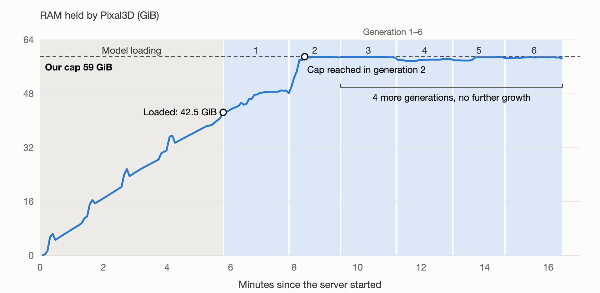

[English](README.md) · [한국어](README.ko.md) · [中文](README.zh-cn.md)

# image-to-3d-pixal3d

A service that turns one picture into a textured 3D model (GLB).

We served Tencent ARC's Pixal3D with model-compose and ran it on an RTX 4090 (24GB). We asked whether this model runs on our hardware and, if so, what it does well and badly; we did not compare it with other models. The official code does not run on a Mac (Apple M2), so we ran one picture there with a third-party 8-bit port. On a DGX Spark (GB10, 128GB unified memory) the official code ran after we set up the CUDA toolkit and Triton, and we measured speed and memory with 5 inputs.

The inputs are famous paintings. We cut 11 objects, such as chairs, shoes, vases and a skull, out of 9 paintings that museums have released into the public domain. The questions come down to one: **how does the model fill in the back that the painter never painted?** Pixal3D's selling point is that it builds 3D while keeping the input picture's viewpoint; with paintings, this showed up as carrying even the painter's brushwork and perspective distortions over into the shape.

A VLM drafted the verdicts by looking at renders from four angles (front, 3/4, side, back), and one author confirmed them.


Figure 1: 3D made from the chair (left) in Van Gogh's The Bedroom (1889). The front (middle) overlaps the painting, but from the side (right) the chair leans sharply. The painting's skewed perspective was carried over into the shape.


Demo: a chair painting uploaded to the web UI (gradio), turned into 3D, and dragged with the mouse through one full turn. Generation took about 3 minutes on an RTX 4090. The generation wait is sped up 60× and the rotation 10× (rendering on the recording Mac's screen was slow).

## Contents

- [Model](#model)
- [Quick start](#quick-start)
- [Summary](#summary)
- [1 Test setup](#1-test-setup)
- [2 Does it run on my machine](#2-does-it-run-on-my-machine)
  - [A 16 GB Mac runs it as an 8-bit port](#a-16-gb-mac-runs-it-as-an-8-bit-port)
  - [A DGX Spark runs it with a matching CUDA toolkit and Triton](#a-dgx-spark-runs-it-with-a-matching-cuda-toolkit-and-triton)
- [3 Results by feature](#3-results-by-feature)
  - [3.1 One picture → 3D](#31-one-picture--3d)
  - [3.2 In the painting's own viewpoint](#32-in-the-paintings-own-viewpoint)
  - [3.3 The unpainted back](#33-the-unpainted-back)
  - [3.4 Automatic background removal](#34-automatic-background-removal)
  - [3.5 Cropped or hidden objects, and faces](#35-cropped-or-hidden-objects-and-faces)
- [4 Recommendations](#4-recommendations)
- [5 Limits and what we did not measure](#5-limits-and-what-we-did-not-measure)
- [License](#license)

## Model

[`TencentARC/Pixal3D`](https://huggingface.co/TencentARC/Pixal3D) is a model that builds a textured (PBR) 3D mesh from a single image (SIGGRAPH 2026, [paper](https://arxiv.org/abs/2605.10922)). The repository's weights are 46GB and include a checkpoint for multi-view input.
Other image-to-3D models build the object in a fixed canonical pose and use the input picture only as a condition; Pixal3D instead lifts the picture's pixels back into 3D space and stacks them. So the result sits in the input picture's own viewpoint, and seen from the front it overlaps the picture. The official materials call this "approaching the fidelity level of reconstruction".

## Quick start

You need [model-compose](https://github.com/hanyeol/model-compose) 0.4.113 or later: `pip install "model-compose>=0.4.113"`. Pixal3D runs only on Linux with an NVIDIA GPU (CUDA) (for a Mac, see [the port in section 2](#a-16-gb-mac-runs-it-as-an-8-bit-port); a DGX Spark needs [a matching CUDA toolkit and Triton](#a-dgx-spark-runs-it-with-a-matching-cuda-toolkit-and-triton)).

The background removal step uses the gated model [`briaai/RMBG-2.0`](https://huggingface.co/briaai/RMBG-2.0). Accept this model's license (non-commercial only) on Hugging Face, then log in.

```bash
hf auth login            # or, in this shell, export HF_TOKEN=...
model-compose up
```

Once the model loads, a web UI opens at `http://localhost:8104`. Upload a picture and you get a 3D you can rotate. The HTTP API is at `http://localhost:8103/api`. To change ports, copy `.env.sample` to `.env` and edit `PORT` and `SERVER_PORT`.

The first start takes a long time, because it builds CUDA extensions (nvdiffrast, CuMesh and others) and downloads the weights. On the 4090 it took about 30 minutes, so the config sets `start_timeout: 2h`. On the DGX Spark, building flash-attn and natten from source alone took about 73 minutes.

**Memory.** This config uses `low_vram: true` (a mode that keeps the stage models in system RAM) and `resolution: 1024`. A 24GB GPU needed `low_vram` (with it off, both 1536 and 1024 ran out of GPU memory). In exchange it uses a lot of system RAM (in our runs it filled the 59GiB cap). We did not test 1536 with `low_vram` on. On a 64GB RAM PC, keep almost nothing else running (Section 2). On the DGX Spark's unified memory, `low_vram` appeared to use more memory, not less, so turn it off there.

Example request:

```bash
curl -o chair.glb localhost:8103/api/workflows/runs \
  -F workflow_id=generate -F wait_for_completion=true -F output_only=true \
  -F "input.image=@chair.png" -F input.seed=7
```

The result is one GLB file (about 1 million faces, 4096×4096 texture, 35–45MB). `decimation_target` (face count) and `texture_size` (texture size) can shrink it, but we did not measure that this time.

## Summary

Each input was generated once (seed 7; only The Bedroom chair twice). One author confirmed the verdicts.

1. On an RTX 4090, one 3D took a median of 115 s (12 runs, 83–200 s) and about 19.4GiB of GPU memory. Getting there required turning on `low_vram`, which keeps the stage models in system RAM, and then RAM filled up to the cap we set on the 64GB PC (59GiB). Each server start left at most 3 results before the worker process was usually terminated at the cap, but RAM did not keep growing with each generation ([Section 2](#2-does-it-run-on-my-machine)).
2. With `low_vram` off, at generation resolution 1536 (default) GPU memory was already at 22.45GiB just before generation, and at both 1536 and 1024 generation failed with GPU out-of-memory as soon as it started ([Section 2](#2-does-it-run-on-my-machine)).
3. All 11 paintings produced a 3D mesh, and except for one milk jug hidden by a hand, each was a continuous solid when rotated. Of the 4 judged on shape, 2 had the same silhouette as the painting, and 2 had the overall outline right but lost some parts or were torn on the sides and back ([3.1](#31-one-picture--3d)).
4. All 3 results judged for viewpoint sat in the painting's own viewpoint, tilt and placement. So the painting's perspective distortions also became shape. Van Gogh's chair leans sharply when seen from the side ([3.2](#32-in-the-paintings-own-viewpoint)).
5. The unpainted back continued plausibly on the chair, the shoes and the basket, but was sometimes filled simply, with a smooth dark hemisphere or a rough lump. On the skull, the glass attached behind it was mashed ([3.3](#33-the-unpainted-back)).
6. In 5 of the 7 judged for background removal, the floor, table or background became a flat slab attached to the object. No object itself was cut away ([3.4](#34-automatic-background-removal)).
7. The milk jug hidden by a hand became not a solid but a relief, with the whole picture raised like a slab. Cropped wider so its outline shows, it got a round body and a back, but the hands holding it stuck on as one lump. Seurat's watering can, cropped at the painting's edge, was built out including the cropped spout ([3.5](#35-cropped-or-hidden-objects-and-faces)).
8. The official code does not run on an Apple M2 16GB, but a third-party 8-bit port made The Bedroom chair in about 34 minutes. Comparing the four-angle renders without judging, its shape was nearly the same as the 4090 result ([section 2](#a-16-gb-mac-runs-it-as-an-8-bit-port)).
9. A DGX Spark (GB10, 128GB unified memory) ran the official code after we matched the CUDA toolkit and Triton to the GB10 GPU. With the same settings as the 4090, the chair took 169 s (4090: 143 s) and the skull 392 s (4090: 136 s). With `low_vram` on, the worker grew to 89.6GiB; with it off, at generation resolution 1536 (default), the whole device used about 47GiB and made three in a row on one server start ([section 2](#a-dgx-spark-runs-it-with-a-matching-cuda-toolkit-and-triton)).

Table 1: Summary by device

| Device | Runs? | One 3D | Peak memory |
|---|---|---|---|
| Apple M2 16GB | The official code does not (CUDA-only). A third-party 8-bit port ran one picture | About 34 min (1 picture, incl. 8 min background removal) | Not measured (swap +3.3GB) |
| RTX 4090 24GB (64GB RAM) | Runs with `low_vram` on. RAM fills our 59GiB cap, so each server hit the cap after at most 3 results | 115 s (median) | GPU 19.4GiB, system RAM up to the 59GiB cap |
| DGX Spark (GB10, 128GB unified memory) | Runs with a matching CUDA toolkit and Triton (built with CUDA 12.9, Triton 3.5.1). Also runs with `low_vram` off at resolution 1536 | 169–420 s (`low_vram` on, 1024), 255–305 s (off, 1536) | Whole device about 47GiB (`low_vram` off). With it on, the worker alone 89.6GiB |

The memory column measures different things per device, so the numbers cannot be compared directly: GPU memory and the measured process group's RAM on the 4090, whole-device usage (`free`) and the worker's RSS on the DGX Spark, and swap growth on the Mac.

## 1 Test setup

Table 2: Devices and methods

| Device | How it ran | Memory measure |
|---|---|---|
| RTX 4090 (24GB, 61.9GiB system RAM, shared) | model-compose 0.4.113 server (`low_vram: true`, `resolution: 1024`), when nothing else was running | GPU memory nvidia-smi reports for the server's processes; system RAM is the usage of the measured process group (cgroup) |
| Apple M2 (16GB, macOS 26.5) | The Metal binary of the third-party port [pixal3d.cpp](https://github.com/raven38/pixal3d.cpp) (release `showcase-assets-sv-1`) with 8-bit weights. No model-compose | System swap usage (every 2 s) |
| DGX Spark (GB10, 128GB unified memory, aarch64, system CUDA 13.0) | model-compose 0.4.113 server with the same official compose as the 4090 (`low_vram: true`, `resolution: 1024`), plus a copy with `low_vram: false`, `resolution: 1536`. torch 2.7.1+cu128, CUDA 12.9 toolkit (for building), Triton 3.5.1. 100GiB memory cap on the server (systemd scope) | GPU memory nvidia-smi reports for the server's processes (the whole-device value is [N/A] on GB10). Memory comparisons use whole-device usage (`free`) and the worker's RSS |

- Weights: `TencentARC/Pixal3D` revision `b0cb2e1b`. 12 steps per stage, guidance 7.5 (texture 1.0), input read size 512, face target 1 million, texture 4096 (the defaults of the model-compose example).
- Times are the generation time of one 3D. Warmup after startup (repeated 2–5 times until generation time settles) and model loading (mostly 5–6.5 min on the 4090) are not counted. Only the three DGX Spark runs with `low_vram` off had no warmup (Section 2).
- On the 4090 we put a 59GiB RAM cap on the whole measured process group, because without a cap RAM once ran out and the whole machine froze (Section 2). On the DGX Spark the cap was 100GiB.
- The 11 inputs are objects cut from the 9 paintings below and resized to 1024px (two paintings gave two objects each). Backgrounds were not removed. All are images museums have released into the public domain (CC0 or a public-domain mark).

| Artist · Work · Year | Collection | Object cut out |
|---|---|---|
| Vincent van Gogh · The Bedroom · 1889 | Art Institute of Chicago (AIC) | Two straw chairs (back, front) |
| Vincent van Gogh · Shoes · 1888 | The Metropolitan Museum of Art (Met) | A pair of shoes |
| Vincent van Gogh · Roses · 1890 | National Gallery of Art, Washington (NGA) | Bunch of roses and jar |
| Paul Cézanne · The Basket of Apples · c. 1893 | Art Institute of Chicago (AIC) | Basket of apples |
| Édouard Manet · Flowers in a Crystal Vase · c. 1882 | National Gallery of Art, Washington (NGA) | Glass vase and flowers |
| Georges Seurat · The Watering Can – Garden at Le Raincy · c. 1883 | National Gallery of Art, Washington (NGA) | Watering can |
| Willem Claesz Heda · Still Life with a Gilt Cup · 1635 | Rijksmuseum | Gilt cup (surrounding still life included) |
| Johannes Vermeer · The Milkmaid · c. 1660 | Rijksmuseum | Milk jug, the figure's head |
| Pieter Claesz · Still Life with a Skull and a Writing Quill · 1628 | The Metropolitan Museum of Art (Met) | Skull |

- Verdicts: we rendered each 3D from four angles, front (the input picture's viewpoint), 3/4, side and back, into one sheet; a VLM (Claude) looked at it next to the input picture twice, independently, and the lower of the two levels became the draft. The author confirmed the drafts; 93% of drafts (28 of 30) were kept as written. Renders used three.js with indoor ambient lighting. Colors may look slightly different under other render settings.

## 2 Does it run on my machine

**On an RTX 4090 (24GB) it runs only with `low_vram` on.** With `low_vram` off, all of the model's stages go onto the GPU. At generation resolution 1536 (default), 22.45GiB was already in use when generation started, so it could not allocate another 512MB and failed. Lowering the resolution to 1024, it still could not allocate another 1GiB and failed.

With `low_vram` on, the stage models stay in system RAM and only the stage that is needed moves to the GPU. GPU use dropped to 19.4GiB, but system RAM filled up to the cap we set (59GiB) instead. At termination the worker process itself held 58.7GiB, and because of the cap we cannot tell how much it actually needs. This 4090 PC had 61.9GiB of RAM. The first time we ran it without a cap, RAM and swap ran out and remote access was lost for 10 minutes. After that we put a cap (59GiB) on the measured processes, so that going over it terminated only that process and the machine kept running.



Figure 2 (4090): System RAM used by one Pixal3D server (the fourth server of the run that made 7 paintings), including the file cache. It filled to 42.5GiB over 5.8 minutes of model loading and reached our cap (59GiB) during the second generation. After that it did not grow over four more generations (generations 1–4 are warmups, 5–6 are results). In the same run, on servers 1–3 the worker process was terminated when a generation briefly pushed past the cap (3–6 generations per server including warmups, at most 3 results); at that moment the worker process held 58.7GiB. Completing the 7 paintings (sections 3.4 and 3.5) took four server starts.

Table 3: RTX 4090, generation time and output size per painting (input read size 512, seed 7)

| Input | Generation time | Faces | GLB size |
|---|---|---|---|
| Heda gilt cup (still life) | 83 s | 938K | 44.8MB |
| Vermeer milk jug | 99 s | 983K | 34.9MB |
| Van Gogh roses | 106 s | 994K | 43.9MB |
| Manet crystal vase | 107 s | 961K | 39.1MB |
| The Bedroom, front chair | 107 s | 959K | 37.1MB |
| Vermeer figure's head | 109 s | 988K | 35.1MB |
| Cézanne basket of apples | 121 s | 967K | 36.7MB |
| Claesz skull | 136 s | 980K | 41.5MB |
| The Bedroom chair (2 runs) | 143 s, 151 s | 969K | 35.8MB, 35.7MB |
| Van Gogh shoes | 156 s | 949K | 43.6MB |
| Seurat watering can | 200 s | 924K | 40.4MB |

The Bedroom chair was made twice under the same conditions, in the speed and the shape measurements. Peak GPU memory was the same for every input, 19.3–19.4GiB. When we had it read the input picture at 1024 (default 512), both attempts hit the RAM cap and produced no result.

**The DGX Spark (128GB unified memory) ran the official code after we set up the CUDA toolkit and Triton** ([below](#a-dgx-spark-runs-it-with-a-matching-cuda-toolkit-and-triton)). There, reading the input at 1024 and turning `low_vram` off, which failed on the 4090, both ran.

### A 16 GB Mac runs it as an 8-bit port

**The official code does not run on a Mac (Apple M2 16GB).** The inference code hard-codes CUDA and needs CUDA-only extensions such as nvdiffrast, CuMesh and FlexGEMM.

[pixal3d.cpp](https://github.com/raven38/pixal3d.cpp) is a third-party port of Pixal3D to C++ (GGML), and it ships a Metal binary for macOS. [`raven38/pixal3d-sv-q8_0-v1`](https://huggingface.co/raven38/pixal3d-sv-q8_0-v1), which holds only the single-image checkpoints reduced to 8-bit (Q8_0), is 7.54GiB (the original 46GB repository also holds the multiview checkpoints). With this pair we made The Bedroom chair with the same seed 7 and resolution 1024 as on the 4090.

Background removal was done by the port's BiRefNet (a GGUF conversion of `ZhengPeng7/BiRefNet`, 0.82GiB), a different model from the 4090's RMBG-2.0. The viewpoint (FOV) was estimated with MoGe-2 as on the 4090 (38.7°), run on the Mac CPU. The port's estimation script stopped on the CPU running in fp16, so in our copy we passed `use_fp16=False` to `model.infer(...)` in `estimate_transforms_moge.py`.

The downloads are the Metal binary (`trellis-metal-macos-arm64.tar.gz`, 2.6MB; when we downloaded it, it was in the `showcase-assets-sv-1` release, and a file of the same name is now in the `v0.10.x-desktop-alpha` releases), the 7.54GiB weights, `birefnet.gguf` (0.82GiB) and MoGe-2 (about 1.2GB). The estimation script `tools/run_pixal3d_estimated.py` comes from the repository, and MoGe-2 needs its own Python environment with torch and `moge` (the latest `moge` pulls a CUDA-only dependency, so we installed it with `--no-deps`). With the weights and `birefnet.gguf` in one folder (`<models>`), we ran:

```bash
./trellis-cli chair.png cut.glb --bg-only --models <models>        # -> cut_cutout.png
python tools/run_pixal3d_estimated.py --image cut_cutout.png --models <models> \
  --trellis-cli ./trellis-cli --device cpu --seed 7 --res 1024 -o chair.glb
```


Figure 3: 3D made from The Bedroom chair. Top row RTX 4090 (official code), bottom row Mac (8-bit port). From left, front, 3/4, side, back.

- **The shape was nearly the same as the 4090 result.** The tilt seen from the side and the layout of the legs, rungs and back slats matched. At 952K faces and a 33.2MB GLB, the size was also close to the 4090's (969K, 35.8MB).
- **The color differed.** The Mac result was a little duller and had almost none of the teal stains on the 4090 chair (section 5). Background removal and weight precision both differed, so we could not tell which caused it.
- **One picture took about 34 minutes.** Background removal took 8 min 13 s and generation 26 min 10 s (including FOV estimation, model loading and writing the GLB). The port reloads the model on every run, so this cannot be compared directly with the 4090's generation time, which excludes loading (143–151 s for the same chair). In generation, the sparse structure (7.5 min), high-resolution shape (9 min) and texture (5.7 min) took the most.
- **Background removal was unusually slow.** The port's README says about 13 s on a GPU, but here it used 23 min of CPU time over 8 min 13 s. Some operations seem to have fallen back to the CPU, but we did not confirm the cause. Feeding a picture already cut out with transparency skips this step.
- **We did not measure peak memory.** System swap grew 3.3GB during background removal and 0.4GB during generation. Another program (about 3.3GB) was running and 8GB of swap was already in use before we started, so closing other apps may make it faster.
- We ran one picture only, and it did not go through judging (VLM draft and confirmation). We do not know whether the other 10 come out on the Mac as they did on the 4090.

### A DGX Spark runs it with a matching CUDA toolkit and Triton

**On the DGX Spark (NVIDIA GB10, 128GB unified memory, aarch64, system CUDA 13.0), the torch 2.7 (cu128) in this setup does not match the machine's CUDA 13 and GB10 GPU, so it ran only after we set up the CUDA toolkit and Triton.** We ran it with the same model-compose 0.4.113 and official compose as on the 4090, and torch is the same 2.7.1+cu128.

- **Building the CUDA extensions.** This setup uses torch 2.7 (cu128), and with only CUDA 13 on the system the extensions could not be built. We installed a CUDA 12.9 toolkit separately in a user folder. flash-attn and natten had no prebuilt aarch64 wheels we could use, so we built these two from source (about 73 minutes together).
- **Triton.** Triton 3.3.1, which comes with torch 2.7, does not know sm_121 (GB10), and the worker died at the texture stage (`LLVM ERROR: Cannot select: intrinsic %llvm.nvvm.cp.async.commit.group`). We upgraded to Triton 3.5.1 and had it use `ptxas` from CUDA 12.9.

The weights (46GB) were already in that machine's cache, so we did not download them.

Table 4: DGX Spark and RTX 4090 with the same settings (`low_vram` on, generation resolution 1024, seed 7)

| Input | Input read size | DGX Spark | RTX 4090 | Faces (DGX / 4090) | GLB size (DGX / 4090) |
|---|---|---|---|---|---|
| The Bedroom chair | 512 | 169 s | 143 s | 956K / 969K | 35.3MB / 35.8MB |
| The Bedroom chair | 1024 | 176 s | Failed (RAM cap) | 957K / - | 35.5MB / - |
| Claesz skull | 512 | 392 s | 136 s | 969K / 980K | 39.2MB / 41.5MB |
| Claesz skull | 1024 | 420 s | Failed (RAM cap) | 969K / - | 39.0MB / - |

- **The chair took 1.2 times the 4090's time, the skull 2.9 times.** On the DGX Spark the skull took more than twice as long as the chair; on the 4090 the two were close (136 s and 143 s). We did not find out why. In this run the DGX Spark, unlike the 4090, used Triton 3.5.1, and with `low_vram` on the worker ran just under our 100GiB cap (89.6GiB).
- **Reading the input at 1024, which hit the RAM cap on the 4090, ran on the DGX Spark.** It took 5–7% longer than at 512, and face counts were nearly the same.
- **Peak GPU memory was 17.7–18.0GiB, but on unified memory this number does not show how much memory the job holds.** It is the GPU memory nvidia-smi reports for the server's processes (the whole-device value reads [N/A] on GB10). With `low_vram` off at 1536 (below) it was also 17.7–17.8GiB, while the whole device used about 47GiB.

**On unified memory, `low_vram` appeared to use more memory, not less.** With `low_vram` on, the worker process's resident memory (RSS) was 89.6GiB after six generations (five warmups and one result). With it off at 1536, memory use for the whole device was about 47GiB, and three 3D models were made in a row on one server start. The two numbers are not the same measure, though: 89.6GiB is the worker's RSS, which can include weight-file pages mapped into memory, and 47GiB is whole-device usage from `free` at one moment during generation. The `low_vram` server briefly went over the 100GiB cap we set during the seventh generation, and the worker process was terminated. The next two server starts each made six generations in a row (warmups included) without hitting the cap.

**`low_vram` off at generation resolution 1536 (the upstream default) also ran on the DGX Spark.** The 4090 could not run this setting. We remade three paintings with seed 7.

Table 5: DGX Spark, `low_vram` off, generation resolution 1536 (input read size 512, seed 7)

| Input | Generation time | Faces | GLB size |
|---|---|---|---|
| The Bedroom chair | 255 s | 955K | 35.3MB |
| Heda gilt cup (still life) | 273 s | 977K | 43.0MB |
| Seurat watering can | 305 s | 976K | 43.6MB |

These three were timed without a warmup, so the times include the state right after startup and are reference values.


Figure 4: From top, The Bedroom chair on the 4090 (`low_vram` on, 1024) and on the DGX Spark (`low_vram` off, 1536), then the Heda still life and the Seurat watering can in the same order. From left, front, 3/4, side, back.

- **The shapes were nearly the same.**
- **The colors differed in places.** The chair had more dark blue stains on the seat and legs, and the watering can lost most of its pink and came out closer to grey. The Heda still life was nearly the same. The device, `low_vram` and the resolution all differed, so we could not tell which caused it.
- **At this render size we cannot say 1536 is visibly better.** Each was made once. Both settings reduce the result to 1M faces (`decimation_target`) and a 4096 texture, so the chair's face counts at 1024 and 1536 were nearly the same (956K and 955K). We did not compare the meshes before reduction.

## 3 Results by feature

Table 6: Questions and results

| Official claim | Our result |
|---|---|
| One image → 3D asset | All 11 produced a 3D mesh. Of the 4 judged on shape, 2 matched down to the silhouette |
| 3D aligned to the input view | All 3 judged sat in the painting's own viewpoint. The painting's perspective distortions also became shape |
| Near-reconstruction fidelity | The front is very close to the painting. The sides and back showed tears, doubled shapes and simple lumps |
| Automatic background removal | Did not cut into objects, but in 5 of 7 the floor or background stuck on as a slab |
| Lower peak VRAM with low-VRAM mode | True (19.4GiB). System RAM filled the 59GiB cap instead (Section 2) |

### 3.1 One picture → 3D


Figure 5 (4090): From left, input, front, 3/4, back. From top, The Bedroom chair, Heda still life, Seurat watering can, Van Gogh shoes, Cézanne basket of apples, Van Gogh roses.

Table 7: Shape verdicts (does the front silhouette match the painting?)

| Input | Verdict | What we saw |
|---|---|---|
| The Bedroom chair | faithful | The ladder back's three rails, the straw seat, the front legs and stretchers came out as painted |
| Cézanne basket of apples | faithful | Basket, apples, the bottle on the right, and even the cloth and the box underneath are arranged as in the painting |
| Van Gogh shoes | partial | The two shoes and the loose laces are as painted, but on the sides and back the surface tore and has holes |
| Claesz skull | partial | The skull and the mouth of the glass behind it carried over, but the white quill lying below was lost |

- **Rotated, they were solids, not slabs.** Except for the milk jug hidden by a hand (3.5), each continued as an object with thickness from all four angles.
- **In the Heda still life, not just the gilt cup but every object on the table became 3D.** The gilt cup, the green glass, the pewter jug and the salt cellar each stand as solids and are intact even from the back. The pewter jug, though, cropped at the painting's edge, kept its cut face flat.
- **Brushwork became texture.** The orange laces and blue shadows of Van Gogh's shoes and the pink and green dots of Seurat's watering can were applied as they are. Colors also bled, though. On Van Gogh's roses the green wall color bled across the whole bouquet, and the chair and shoes picked up teal stains that are not in the paintings. Texture verdicts for 4 inputs: bleeding 3, wrong 1 (shoes).

### 3.2 In the painting's own viewpoint

> Paper: "Instead of generating in a canonical pose, Pixal3D directly generates 3D in a pixel-aligned way, consistent with the input view."

All 3 judged inputs (The Bedroom chair, Van Gogh shoes, Cézanne basket of apples) sat in the painting's own viewpoint, tilt and placement. The chair, seen at an angle from above, was at the same angle in the result's front view, and the front-to-back order of the two overlapping shoes and the direction of the loose laces were also the same.

**This property carries over even the painting's distortions.** In The Bedroom, the floor and furniture are painted with inconsistent perspective. Pixal3D built the chair to overlap the painting from the front, and as a result the chair leans far back when seen from the side (Figure 1). In a front-only verdict this was "matches", but using it as a 3D asset needs a fix to stand it upright.

### 3.3 The unpainted back

Table 8: Back verdicts (do shape and color continue from the front?)

| Input | Verdict | What we saw |
|---|---|---|
| The Bedroom chair | plausible | The back legs and the back of the backrest continue. The legs are knobbly like branches, and some places are doubled |
| Van Gogh shoes | plausible | The heels and sides of the shoes continue, but the surface is torn in many places |
| Cézanne basket of apples | plausible | The back of the basket was filled with a smooth dark hemisphere. No apples are visible |
| Claesz skull | broken | The back of the head looks natural, but the glass attached beside it became a mashed lump |

- **The back was filled with the simplest shape.** The back of the basket was a plain hemisphere, and the back of the Vermeer figure's head was a rough brown lump.
- **We included the skull as a control whose back can be checked by common sense.** The curved back of the cranium looked natural. The problem was that the glass leaning against the skull in the painting was fused into one lump with it.

### 3.4 Automatic background removal

> Official GitHub: "Views need not be RGBA — any view without an alpha channel is matted with the same background-removal model `inference.py` uses."

Of the 7 judged for background removal, 2 (Manet crystal vase, The Bedroom front chair) were left with only the object, and in 5 the floor or background stuck on as a slab.

- **What remained most often was the floor the object stands on.** On Van Gogh's roses the green table stuck on under the vase as a slanted slab, and on Seurat's watering can the pink dirt path stuck on as a square base.
- **No object body was cut away.** The watering can's handle, the chair's rails and even the thin leaves above the vase remained.
- **A complex background did not always lead to failure.** The Bedroom front chair, painted together with a blue wall, a green floor, hanging cloth and another chair, came out clean, with only the chair left.
- **Transparent glass became opaque.** Manet's crystal vase separated well from the background, but the glass became a milky lump.

We do not know whether the slabs are left over from the background removal step or produced in the 3D generation step. We did not look at the mask right after background removal separately.

### 3.5 Cropped or hidden objects, and faces


Figure 6 (4090): From left, input, front, side, back. From top, Vermeer milk jug, Vermeer figure's head, Manet crystal vase, Claesz skull, The Bedroom front chair.

- **An object hidden by a hand became a relief.** Vermeer's milk jug, with the hand, the blue cloth and even the brown background attached, rose as a whole picture like a thick slab. From the side it is thin.
- **An object cropped at the painting's edge was sometimes built out.** Seurat's watering can was built out to the end of the spout cropped at the right edge. The pewter jug in the Heda still life kept its cut face flat as it was.
- **A precisely painted face looked like the painting only from the front.** From the front, the Vermeer figure's head had the headscarf, face and yellow garment as painted, but the sides and back were a rough lump and the bottom was cut flat (verdict: partial).
- **The other chair from the same painting had bleeding colors.** The Bedroom front chair was clean in shape, but seen from the back, the green floor color had rubbed off onto the chair.


Figure 7 (DGX Spark): The Vermeer milk jug cut wider. From left, input, front, 3/4, side, back.

**Cutting wider undid the relief, but the hands stuck on.** We cut the same painting again, wider so the jug's whole outline shows (region 1220,2300–2080,3160 of the original). We made it on the DGX Spark with the same settings (`low_vram` on, 1024, seed 7), and it took 305 s (990K faces, 38.2MB). The relief came apart into a round body with a back, but the two hands holding the jug and the blue sleeve became one lump attached to the body. The original ran on the 4090 and this one on the DGX Spark, so this is not a crop-only comparison. From this one run, the hands covering the jug look like a bigger cause than the crop.

## 4 Recommendations

- On a 24GB GPU, start with `low_vram: true` and `resolution: 1024`. With 64GB of system RAM, close other large programs. Without a cap RAM can run out and freeze the machine. We put a RAM cap (59GiB) on the server process and restarted the server when the worker process was terminated at the cap. We did not measure how much headroom a PC with more RAM gives.
- On a DGX Spark (128GB unified memory), set `low_vram: false`. With it on, the worker grew to 89.6GiB and was killed once at our 100GiB cap. With it off at 1536, the whole device used about 47GiB. Getting it to run needs the CUDA toolkit and Triton setup in section 2.
- Start the server once and process several pictures in a row. Model loading takes 5–6.5 minutes, about three times the time to make one 3D (about 2 minutes).
- Remove the background beforehand so only the object is left. With the background in, the floor or background stuck on as a slab in 5 of 7 (we did not check whether removing it beforehand makes the slab go away).
- Avoid pictures where the object is hidden by a hand or another object. The hand or object doing the covering rises as a slab along with it.
- If you put in a painting or an illustration, check the tilt from the side. The picture's perspective distortions become shape as they are.
- For assets that will be shown rotating, check the sides and back yourself and fix them. Even when the front matches the picture, the back may be a simple lump.
- On a 16GB Mac without an NVIDIA GPU, use the 8-bit port (pixal3d.cpp). One picture took about 34 minutes, so feed pictures with the background already removed to skip that step (8 min this time) and close other large apps.

## 5 Limits and what we did not measure

### Main defect: the background sticks on as a slab

In 5 of the 7 judged for background removal, the floor or table the object stands on, or part of the background, became a flat slab or base attached to the object (the watering can and roses in Figure 5, the milk jug in Figure 6). Using them for 3D printing or as game assets needs a fix that removes the slab. We did not compare against the same paintings with the background removed beforehand, so we did not confirm whether removing it beforehand makes the slab go away.

### Other limits

These are effects seen repeatedly across results, and hypotheses we could not confirm. All were seen in results generated only once per input.

| Effect | Where seen | Unconfirmed hypothesis |
|---|---|---|
| Floor or background stuck on as a slab | Watering can, roses, milk jug, figure's head | Does it stick in the same place with a different seed (is it decided by the floor in the painting)? |
| Holes and tears in side and back surfaces | Shoes, figure's head, chair | Do they shrink if the input is read at 1024 (the 4090 hit the RAM cap; the DGX Spark made the chair and skull at 1024, but this report does not compare their surfaces)? |
| Teal stains not in the painting | Chair, shoes | Is this the painting's wall or floor color bleeding? |
| Back is a simple dark lump | Basket of apples, figure's head | |
| Face cut at the painting's edge left flat | Heda pewter jug, figure's head | Is it decided by the painting's border? |
| Scattered thin fragments | Floor of the Heda still life | |

- Each input was generated once with one seed (7). The Bedroom chair, made twice with the same seed, gave GLBs of slightly different size (35.8MB and 35.7MB), but we did not compare how much the shapes differ. We did not measure how much results vary with the seed either.
- We did not make GLBs with reduced face count and texture size (for games and the web). On the 4090 the RAM cap allowed at most 3 per server start, so we spent the time on adding more paintings.
- We put in no real photos. Every input is an oil painting.
- We did not test multi-view input (the feature that takes photos from several angles together), because it needs camera poses.
- We did not re-measure the paper's numbers (IoU on Toys4K and others), and did not compare with other image-to-3D models.
- Results were judged only from the four-angle render images. We did not check whether the meshes are watertight or whether the UVs are clean.
- We measured the official code on one 4090 PC and one DGX Spark (the Mac ran one picture with the port). The DGX Spark made only 5 inputs. We do not know how many pictures in a row are safe with `low_vram` on a PC with more RAM. Even on the DGX Spark, one server start was killed at the cap, and two others made six generations in a row.
- We did not measure the size of the weights downloaded on first install. Some were already in the 4090's shared cache, and all 46GB were already in the DGX Spark's cache.

## License

| Item | License | Commercial use |
|---|---|---|
| This repository (config files, docs) | [MIT](LICENSE) | ✓ |
| `TencentARC/Pixal3D` code and weights | [MIT](https://huggingface.co/TencentARC/Pixal3D) | ✓ |
| `briaai/RMBG-2.0` (background removal) | [bria-rmbg-2.0](https://huggingface.co/briaai/RMBG-2.0) | ✗ Non-commercial only |
| DINOv3, MoGe-2 (models Pixal3D downloads alongside) | Each repository's license | Not checked |
| pixal3d.cpp and `raven38/pixal3d-sv-q8_0-v1` (Mac port) | [MIT](https://github.com/raven38/pixal3d.cpp); among the weights only `dinov3.gguf` is under the DINOv3 License | Port ✓, DINOv3 not checked |
| BiRefNet (the port's background removal) | Original [MIT](https://huggingface.co/ZhengPeng7/BiRefNet); the conversion `ilintar/trellis2-gguf` is other | Not checked |
| Painting images used as inputs | Public-domain release by each museum | ✓ |

- Pixal3D is MIT, but the default pipeline's background removal step uses a non-commercial-only model. For commercial use, put in pictures with the background already removed or swap the background removal model.
- The Pixal3D model card carries a flag that blocks use in the EU (`extra_gated_eu_disallowed`), but the repository itself is not gated. We did not check the terms of use in the EU.
- The painting images were cropped from releases by the Art Institute of Chicago (CC0), The Metropolitan Museum of Art (Open Access), the National Gallery of Art, Washington (Open Access) and the Rijksmuseum (public domain).
