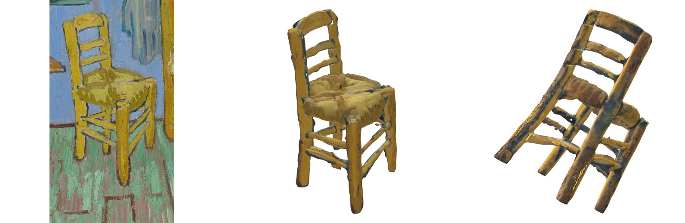
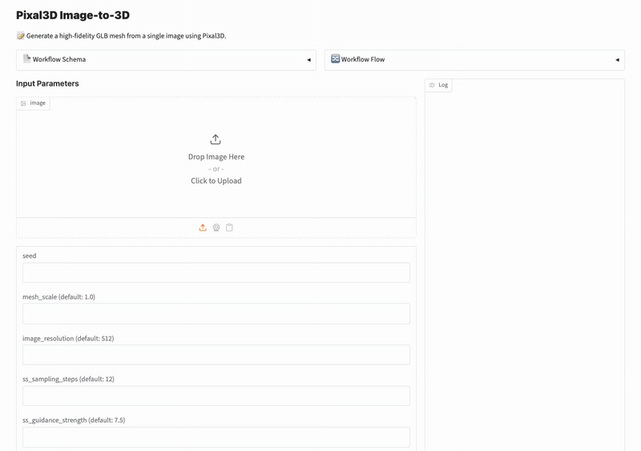
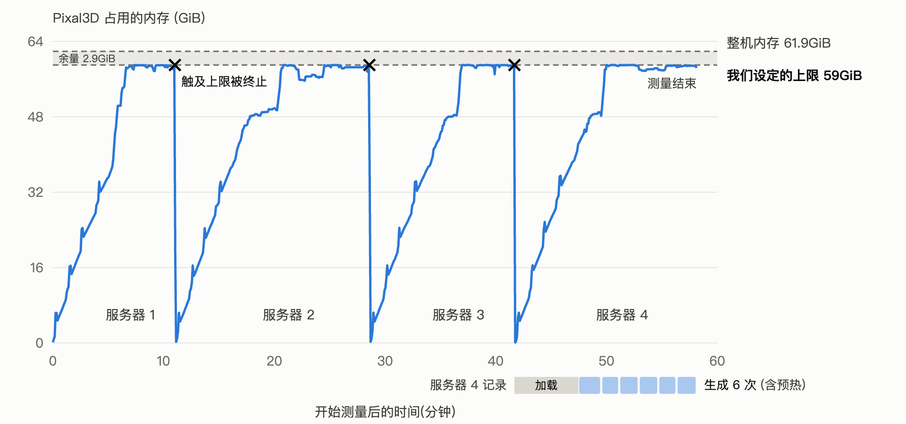
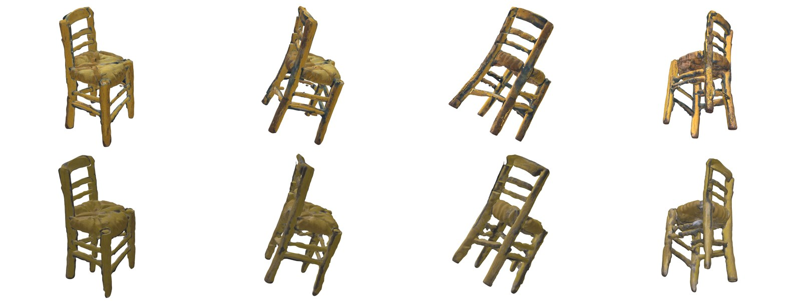
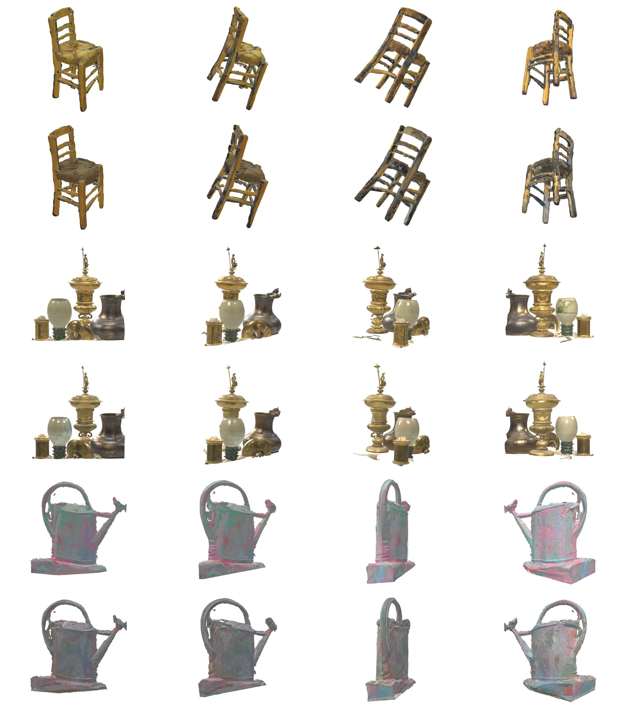
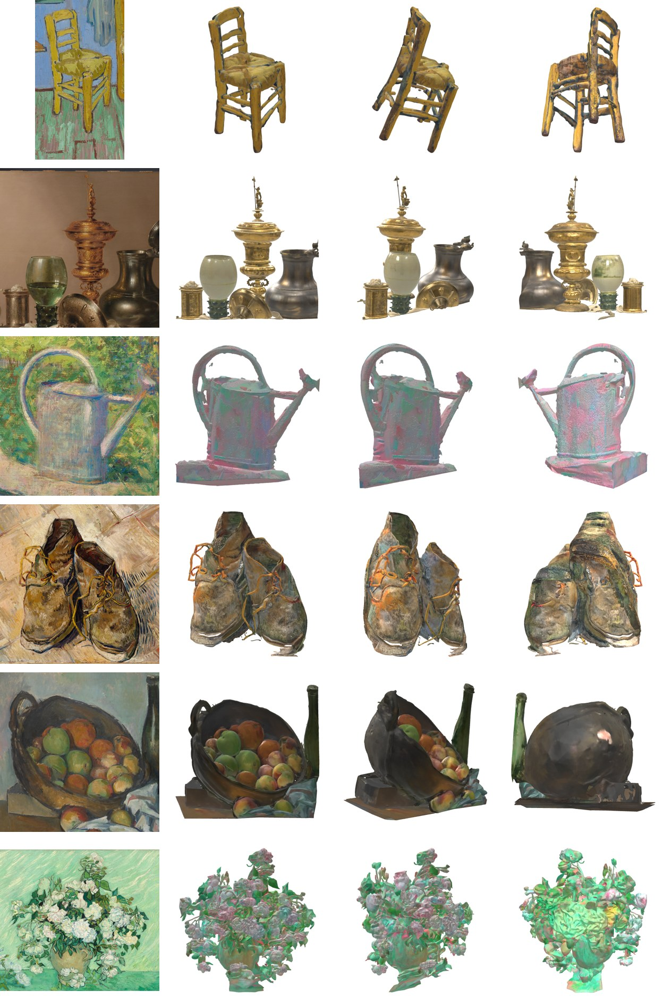
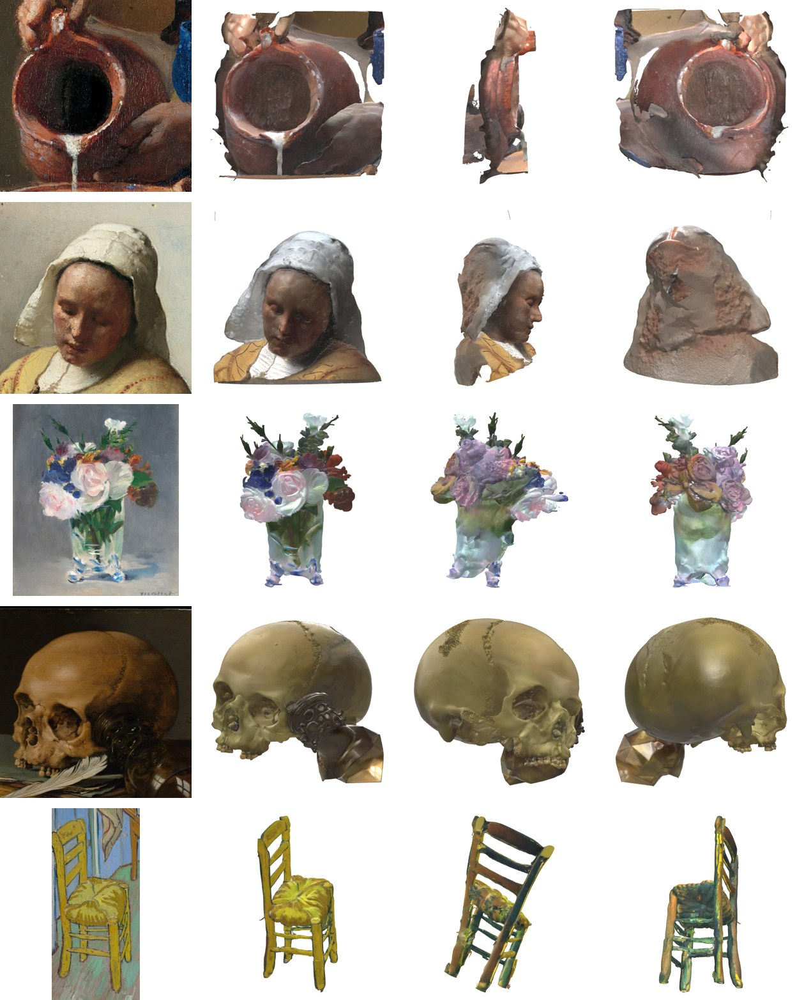
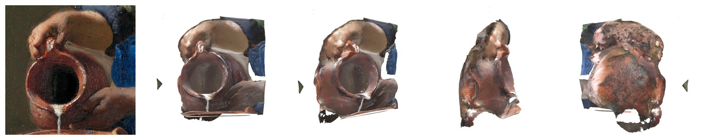

[English](README.md) · [한국어](README.ko.md) · [中文](README.zh-cn.md)

# image-to-3d-pixal3d

一个服务：传入一张画，生成贴有纹理的 3D 模型（GLB）。

我们用 model-compose 部署了 Tencent ARC 的 Pixal3D，并在 RTX 4090（24GB）上运行。我们关注的是这个模型能否在自己的设备上运行，以及能运行时擅长什么、不擅长什么，没有与其他模型比较。官方代码无法在 Mac（Apple M2）上运行，因此用第三方 8 比特移植版在 Mac 上只跑了一张画。在 DGX Spark（GB10，128GB 统一内存）上，配好 CUDA 工具包和 Triton 后官方代码可以运行，我们用 5 个输入测量了速度和内存。

输入是名画。从美术馆以公有领域公开的 9 幅画中，裁出椅子、鞋、花瓶、头骨等 11 个物体作为输入。问题归结为一个：**画家没有画出的背面，模型如何补全。** Pixal3D 主打按输入图像的视角原样生成 3D，而在画作上，这一特性表现为把画家的笔触和透视变形也转移成了形状。

结果由 VLM 查看从四个角度（正面、3/4、侧面、背面）渲染的图像起草判定，再由作者 1 人确认。



图 1：用梵高《卧室》（1889）中的椅子（左）生成的 3D。正面（中）与画重合，但从侧面（右）看，椅子明显倾斜。画中歪斜的透视被转移成了形状。



演示：把椅子画上传到网页 UI（gradio）生成 3D，再用鼠标拖动旋转一圈。在 RTX 4090 上生成约用了 3 分钟。生成等待加速了 60 倍，旋转加速了 10 倍（录屏所用 Mac 画面的渲染较慢）。

## 目录

- [模型](#模型)
- [快速开始](#快速开始)
- [摘要](#摘要)
- [1 实验环境](#1-实验环境)
- [2 能在我的设备上运行吗](#2-能在我的设备上运行吗)
  - [16GB Mac 可以用 8 比特移植版运行](#16gb-mac-可以用-8-比特移植版运行)
  - [DGX Spark 要配好 CUDA 工具包和 Triton 才能运行](#dgx-spark-要配好-cuda-工具包和-triton-才能运行)
- [3 各功能结果](#3-各功能结果)
  - [3.1 一张画 → 3D](#31-一张画--3d)
  - [3.2 保持画的视角](#32-保持画的视角)
  - [3.3 没有画出的背面](#33-没有画出的背面)
  - [3.4 自动去除背景](#34-自动去除背景)
  - [3.5 被截断或被遮挡的物体、面部](#35-被截断或被遮挡的物体面部)
- [4 建议](#4-建议)
- [5 局限与未测量的内容](#5-局限与未测量的内容)
- [许可证](#许可证)

## 模型

[`TencentARC/Pixal3D`](https://huggingface.co/TencentARC/Pixal3D) 是一个从单张图像生成贴有纹理（PBR）的 3D 网格的模型（SIGGRAPH 2026，[论文](https://arxiv.org/abs/2605.10922)）。仓库权重为 46GB，同时包含多视图用的检查点。
其他图像→3D 模型把物体生成为固定的标准姿态，只把输入图像用作条件，而 Pixal3D 把图像的像素反投影回 3D 空间并堆叠起来。因此结果按输入图像本身的视角原样摆放，从正面看与画重合。官方资料称之为"接近重建水平的保真度"（approaching the fidelity level of reconstruction）。

## 快速开始

需要 [model-compose](https://github.com/hanyeol/model-compose) 0.4.113 或以上版本：`pip install "model-compose>=0.4.113"`。Pixal3D 只能在带 NVIDIA GPU（CUDA）的 Linux 上运行（Mac 见[第 2 章的移植版](#16gb-mac-可以用-8-比特移植版运行)，DGX Spark 需要[配好 CUDA 工具包和 Triton](#dgx-spark-要配好-cuda-工具包和-triton-才能运行)）。

背景去除步骤使用需要审批的模型 [`briaai/RMBG-2.0`](https://huggingface.co/briaai/RMBG-2.0)。请先在 Hugging Face 上同意该模型的许可证（仅限非商业用途），然后登录。

```bash
hf auth login            # 或在此 shell 中 export HF_TOKEN=...
model-compose up
```

模型加载后会打开网页 UI（`http://localhost:8104`）。上传一幅画即可得到可以旋转查看的 3D。HTTP API 在 `http://localhost:8103/api`。如需修改端口，把 `.env.sample` 复制为 `.env` 并修改 `PORT`、`SERVER_PORT`。

首次启动时要构建 CUDA 扩展（nvdiffrast、CuMesh 等）并下载权重，耗时较长。在 4090 上用了约 30 分钟，所以在配置里加了 `start_timeout: 2h`。在 DGX Spark 上，仅从源码构建 flash-attn 和 natten 就用了约 73 分钟。

**内存。** 此配置为 `low_vram: true`、`resolution: 1024`。要在 24GB GPU 上运行就需要这个设置，代价是占用约 59GiB 系统内存。在 64GB 内存的 PC 上几乎不能再开其他程序（第 2 章）。在 DGX Spark 的统一内存上，`low_vram` 看起来没有减少内存，反而用得更多，因此在那里应关闭。

请求示例：

```bash
curl -o chair.glb localhost:8103/api/workflows/runs \
  -F workflow_id=generate -F wait_for_completion=true -F output_only=true \
  -F "input.image=@chair.png" -F input.seed=7
```

结果是一个 GLB 文件（约 100 万个面，纹理 4096×4096，35~45MB）。可以用 `decimation_target`（面数）、`texture_size`（纹理尺寸）缩小，但这次没有测量。

## 摘要

每个输入生成了一次（seed 7，只有梵高《卧室》椅子生成了两次）。判定由作者 1 人确认。

1. 在 RTX 4090 上生成一个 3D 的中位数为 115 秒（83~200 秒），GPU 显存约 19.4GiB。不过要做到这一点，必须开启把各阶段模型放在系统内存中的 `low_vram`，此时占用约 59GiB 内存。在 64GB 的 PC 上，每次启动服务器后最多生成 3 个就因内存不足而停止（[第 2 章](#2-能在我的设备上运行吗)）。
2. 关闭 `low_vram` 时，在生成分辨率 1536（默认）下，生成开始前 GPU 显存已占用 22.45GiB；1536 和 1024 都在开始生成后立即因显存不足而失败（[第 2 章](#2-能在我的设备上运行吗)）。
3. 11 幅名画全部生成了 3D 网格，除了被手遮挡的一个牛奶壶，转动查看都是连贯的立体。判定形状的 4 幅中，2 幅剪影与画相同，2 幅大致轮廓吻合，但部分缺失或侧面·背面撕裂（[3.1](#31-一张画--3d)）。
4. 结果全部按画的视角、倾斜和布局原样摆放。因此画中的透视变形也成了形状。梵高的椅子从侧面看明显倾斜（[3.2](#32-保持画的视角)）。
5. 没有画出的背面在椅子、鞋和篮子上合理地延续了下来，但有时也被简单地填成光滑的暗色半球或粗糙的团块。头骨背后贴着的玻璃杯糊成了一团（[3.3](#33-没有画出的背面)）。
6. 未去除背景的 7 幅画中有 5 幅，地面、桌面或背景变成扁平的板粘在物体上。没有出现把物体本身削掉的情况（[3.4](#34-自动去除背景)）。
7. 被手遮挡的牛奶壶没有成为立体，而是整幅画像板一样隆起的浮雕。重新裁宽、让轮廓完整露出后，出现了圆形壶身和背面，但握壶的手粘成了一团。在画边缘被截断的修拉的浇水壶，连被截断的壶嘴也延续生成了出来（[3.5](#35-被截断或被遮挡的物体面部)）。
8. 官方代码无法在 Apple M2 16GB 上运行，但第三方 8 比特移植版用约 34 分钟生成了梵高《卧室》的椅子。不经判定、对照四个角度的渲染来看，形状与 4090 的结果几乎相同（[第 2 章](#16gb-mac-可以用-8-比特移植版运行)）。
9. 在 DGX Spark（GB10，128GB 统一内存）上，针对 GB10 GPU 配好 CUDA 工具包和 Triton 后，官方代码可以运行。与 4090 相同的设置下，椅子用了 169 秒（4090 为 143 秒），头骨用了 392 秒（4090 为 136 秒）。开启 `low_vram` 时工作进程涨到 89.6GiB；关闭后以生成分辨率 1536（默认）整机约用 47GiB，在一次服务器启动中连续生成了 3 个（[第 2 章](#dgx-spark-要配好-cuda-工具包和-triton-才能运行)）。

表 1：各设备摘要

| 设备 | 能否运行 | 生成一个 3D | 峰值内存 |
|---|---|---|---|
| Apple M2 16GB | 官方代码不能运行（仅支持 CUDA）。第三方 8 比特移植版跑通了 1 张 | 约 34 分钟（1 张，含去除背景 8 分钟） | 未测得（交换空间 +3.3GB） |
| RTX 4090 24GB（内存 64GB） | 开启 `low_vram` 可以运行，但每个服务器最多生成 3 个后因内存不足停止 | 115 秒（中位数） | GPU 19.4GiB，系统内存约 59GiB |
| DGX Spark（GB10，128GB 统一内存） | 配好 CUDA 工具包和 Triton 后可以运行（用 CUDA 12.9 构建、Triton 3.5.1）。关闭 `low_vram`、分辨率 1536 也能运行 | 169~420 秒（开启 `low_vram`，1024），255~305 秒（关闭，1536） | 整机约 47GiB（关闭 `low_vram`）。开启时仅工作进程就 89.6GiB |

内存一栏在各设备上测的对象不同，不能直接比较：4090 是 GPU 显存和测量进程组的内存，DGX Spark 是整机占用（`free`）和工作进程 RSS，Mac 是交换空间的增量。

## 1 实验环境

表 2：测量设备与方式

| 设备 | 运行方式 | 内存口径 |
|---|---|---|
| RTX 4090（24GB，系统内存 61.9GiB，共用） | model-compose 0.4.113 服务器（`low_vram: true`，`resolution: 1024`），在没有其他任务时 | nvidia-smi 报告的服务器进程 GPU 显存；系统内存为测量进程组（cgroup）的占用 |
| Apple M2（16GB，macOS 26.5） | 第三方移植版 [pixal3d.cpp](https://github.com/raven38/pixal3d.cpp) 的 Metal 可执行文件（发布版 `showcase-assets-sv-1`）与 8 比特权重。未使用 model-compose | 系统交换空间占用（每 2 秒） |
| DGX Spark（GB10，128GB 统一内存，aarch64，系统 CUDA 13.0） | model-compose 0.4.113 服务器。与 4090 相同的官方 compose（`low_vram: true`，`resolution: 1024`），以及改为 `low_vram: false`、`resolution: 1536` 的副本。torch 2.7.1+cu128，CUDA 12.9 工具包（用于构建），Triton 3.5.1。服务器内存上限 100GiB（systemd scope） | nvidia-smi 报告的服务器进程 GPU 显存（GB10 上整机数值为 [N/A]） |

- 权重为 `TencentARC/Pixal3D` 修订版 `b0cb2e1b`。每个阶段 12 步，guidance 7.5（纹理 1.0），读取输入的尺寸 512，面数目标 100 万，纹理 4096（model-compose 示例的默认值）。
- 时间是生成一个 3D 的时间。启动服务器后的首个请求（预热）和模型加载（在 4090 上大多为 5~6.5 分钟）不计入。只有 DGX Spark 上关闭 `low_vram` 的 3 个没有预热（第 2 章）。
- 在 4090 上对整个测量进程设置了 59GiB 的内存上限。因为没有上限时曾出现内存耗尽、整台机器卡死的情况（第 2 章）。DGX Spark 的上限为 100GiB。
- 11 个输入是从下面 9 幅画中裁出物体并缩小到 1024px 得到的（其中两幅画各裁出两个）。没有去除背景。全部是美术馆以公有领域（CC0 或公有领域标记）公开的图像。

| 作者 · 作品 · 年份 | 收藏机构 | 裁出的物体 |
|---|---|---|
| 文森特·梵高 · 《卧室》 · 1889 | 芝加哥艺术博物馆（AIC） | 两把草编椅（后方、前方） |
| 文森特·梵高 · 《鞋》 · 1888 | 大都会艺术博物馆（Met） | 一双鞋 |
| 文森特·梵高 · 《玫瑰》 · 1890 | 美国国家美术馆（NGA） | 玫瑰花束和罐子 |
| 保罗·塞尚 · 《苹果篮》 · 约1893 | 芝加哥艺术博物馆（AIC） | 苹果篮 |
| 爱德华·马奈 · 《水晶花瓶中的花》 · 约1882 | 美国国家美术馆（NGA） | 玻璃花瓶和花 |
| 乔治·修拉 · 《浇水壶》 · 约1883 | 美国国家美术馆（NGA） | 浇水壶 |
| 威廉·克拉斯·赫达 · 《有镀金杯的静物》 · 1635 | 荷兰国家博物馆 | 镀金杯（周围的静物也一并包含） |
| 约翰内斯·维米尔 · 《倒牛奶的女仆》 · 约1660 | 荷兰国家博物馆 | 牛奶壶、人物的头部 |
| 彼得·克拉斯 · 《有头骨和羽毛笔的静物》 · 1628 | 大都会艺术博物馆（Met） | 头骨 |

- 判定：把结果 3D 从正面（输入图像的视角）、3/4、侧面、背面四个角度渲染并拼成一张图，与输入画一起由 VLM（Claude）独立查看两次，取较低的等级作为草稿。草稿由作者确认，草稿原样保留的比例为 93%（30 项中 28 项）。渲染使用 three.js，光照为室内环境光。根据渲染设置，颜色看起来可能略有不同。

## 2 能在我的设备上运行吗

**在 RTX 4090（24GB）上必须开启 `low_vram` 才能运行。** 关闭 `low_vram` 时，模型的各阶段全部加载到 GPU 上。在生成分辨率 1536（默认）下，开始生成时已占用 22.45GiB，无法再分配 512MB 而失败。把分辨率降到 1024，也因无法再分配 1GiB 而失败。

开启 `low_vram` 时，各阶段模型放在系统内存中，只把需要的阶段移到 GPU。GPU 降到了 19.4GiB，但代价是占用约 59GiB 系统内存。这次 4090 PC 的内存为 61.9GiB。最初不设上限运行时，内存和交换空间耗尽，远程连接中断了 10 分钟。此后给测量进程设置了上限（59GiB），超出时只停止测量。



图 2（4090）：Pixal3D 占用的系统内存。启动服务器后，约 7 分钟内接近 59GiB（该值包含文件缓存）。在保留了日志的服务器 4 上，模型加载 5.8 分钟后为 42.5GiB，第二次生成时触及上限（图下方色带）。在这种状态下最多生成 3 个后触及上限，工作进程被终止。终止时工作进程实际持有的内存为 58.7GiB。这张图记录的是生成其中 7 幅（3.4、3.5 节）的那次运行，为完成这 7 幅，服务器启动了四次。

表 3：RTX 4090，各幅画的生成时间与结果大小（读取输入的尺寸 512，seed 7）

| 输入 | 生成时间 | 面数 | GLB 大小 |
|---|---|---|---|
| 赫达镀金杯（静物） | 83 秒 | 93.8 万 | 44.8MB |
| 维米尔牛奶壶 | 99 秒 | 98.3 万 | 34.9MB |
| 梵高玫瑰 | 106 秒 | 99.4 万 | 43.9MB |
| 马奈水晶花瓶 | 107 秒 | 96.1 万 | 39.1MB |
| 梵高《卧室》前方椅子 | 107 秒 | 95.9 万 | 37.1MB |
| 维米尔人物头部 | 109 秒 | 98.8 万 | 35.1MB |
| 塞尚苹果篮 | 121 秒 | 96.7 万 | 36.7MB |
| 克拉斯头骨 | 136 秒 | 98.0 万 | 41.5MB |
| 梵高《卧室》椅子（2 次） | 143 秒、151 秒 | 96.9 万 | 35.8MB |
| 梵高鞋 | 156 秒 | 94.9 万 | 43.6MB |
| 修拉浇水壶 | 200 秒 | 92.4 万 | 40.4MB |

梵高《卧室》椅子在速度测量和形状测量中以相同条件生成了两次。GPU 显存峰值在所有输入上都同为 19.3~19.4GiB。让输入图像以 1024 读取时（默认 512），两次都触及内存上限，没有得到结果。

**DGX Spark（128GB 统一内存）配好 CUDA 工具包和 Triton 后，官方代码可以运行**（[见下文](#dgx-spark-要配好-cuda-工具包和-triton-才能运行)）。在 4090 上失败的以 1024 读取输入和关闭 `low_vram`，在那里都能运行。

### 16GB Mac 可以用 8 比特移植版运行

**官方代码在 Mac（Apple M2 16GB）上无法运行。** 推理代码固定使用 CUDA，并需要 nvdiffrast、CuMesh、FlexGEMM 等仅支持 CUDA 的扩展。

[pixal3d.cpp](https://github.com/raven38/pixal3d.cpp) 是把 Pixal3D 移植到 C++（GGML）的第三方移植版，并提供 macOS 用的 Metal 可执行文件。[`raven38/pixal3d-sv-q8_0-v1`](https://huggingface.co/raven38/pixal3d-sv-q8_0-v1) 只把单图检查点压缩为 8 比特（Q8_0），大小为 7.54GiB（原仓库 46GB 中还包含多视图检查点）。我们用这一组合，以与 4090 相同的 seed 7、分辨率 1024 生成了梵高《卧室》的椅子。

去除背景由移植版使用的 BiRefNet（`ZhengPeng7/BiRefNet` 的 GGUF 转换版，0.82GiB）完成，与 4090 的 RMBG-2.0 是不同的模型。视角（FOV）与 4090 一样用 MoGe-2 估计（38.7°），在 Mac CPU 上运行。移植版的估计脚本在 CPU 上以 fp16 运行时中断，因此我们在副本中给 `estimate_transforms_moge.py` 的 `model.infer(...)` 传入了 `use_fp16=False`。

需要下载的是 Metal 可执行文件（发布版 `trellis-metal-macos-arm64`，2MB）、权重 7.54GiB、`birefnet.gguf` 0.82GiB、MoGe-2 约 1.2GB。估计脚本 `tools/run_pixal3d_estimated.py` 从仓库获取，运行 MoGe-2 还需要另建装有 torch 和 `moge` 的 Python 环境（最新版 `moge` 会带入仅支持 CUDA 的依赖，因此用 `--no-deps` 安装）。把权重和 `birefnet.gguf` 放在同一文件夹（`<models>`）后，这样运行：

```bash
./trellis-cli chair.png cut.glb --bg-only --models <models>        # -> cut_cutout.png
python tools/run_pixal3d_estimated.py --image cut_cutout.png --models <models> \
  --trellis-cli ./trellis-cli --device cpu --seed 7 --res 1024 -o chair.glb
```



图 3：用梵高《卧室》椅子生成的 3D。上排为 RTX 4090（官方代码），下排为 Mac（8 比特移植版）。从左到右为正面、3/4、侧面、背面。

- **形状与 4090 的结果几乎相同。** 从侧面看的倾斜、椅腿与横档、靠背横条的排布都一致。面数 95.2 万、GLB 33.2MB，大小也与 4090（96.9 万、35.8MB）相近。
- **颜色不同。** Mac 的结果稍暗，4090 椅子上的青绿色污渍（第 5 章）几乎没有出现。去除背景的模型和权重精度同时不同，因此无法区分是哪一个造成的。
- **一张约需 34 分钟。** 去除背景 8 分 13 秒，生成 26 分 10 秒（含 FOV 估计、读取模型和写入 GLB）。移植版每次运行都重新读取模型，因此不能与不含加载时间的 4090 生成时间（同一把椅子 143~151 秒）直接比较。生成中耗时最多的是稀疏结构 7.5 分钟、高分辨率形状 9 分钟、纹理 5.7 分钟。
- **去除背景格外慢。** 移植版 README 写的是 GPU 上约 13 秒，但这次 8 分 13 秒中用了 23 分钟 CPU 时间。看起来部分运算落到了 CPU 上，但没有确认原因。输入事先去除背景、带透明度的画即可跳过这一步。
- **没有测得峰值内存。** 系统交换空间在去除背景时增加 3.3GB，生成时增加 0.4GB。测量时另有程序（约 3.3GB）在运行，开始前交换空间已用 8GB，关闭其他应用可能会更快。
- 只跑了一张画，也没有经过判定（VLM 初稿与确认）。其余 10 件在 Mac 上是否与 4090 一样，尚不清楚。

### DGX Spark 要配好 CUDA 工具包和 Triton 才能运行

**在 DGX Spark（NVIDIA GB10，128GB 统一内存，aarch64，系统 CUDA 13.0）上，Pixal3D 固定的 torch 2.7 与机器的 CUDA 13 和 GB10 GPU 不匹配，配好 CUDA 工具包和 Triton 后才能运行。** 运行时使用与 4090 相同的 model-compose 0.4.113 和官方 compose，torch 版本也与 4090 相同，为 2.7.1+cu128。

- **构建 CUDA 扩展。** Pixal3D 固定使用 torch 2.7（cu128），而系统只有 CUDA 13，无法构建扩展。我们在用户目录另装了 CUDA 12.9 工具包。flash-attn 和 natten 没有可用的 aarch64 预编译 wheel，这两个从源码构建（合计约 73 分钟）。
- **Triton。** torch 2.7 附带的 Triton 3.3.1 不认识 sm_121（GB10），工作进程在纹理阶段崩溃（`LLVM ERROR: Cannot select: intrinsic %llvm.nvvm.cp.async.commit.group`）。我们把 Triton 升到 3.5.1，并让它使用 CUDA 12.9 的 `ptxas`。

权重（46GB）已在那台设备的缓存中，因此没有下载。

表 4：相同设置下的 DGX Spark 与 RTX 4090（开启 `low_vram`，生成分辨率 1024，seed 7）

| 输入 | 读取输入的尺寸 | DGX Spark | RTX 4090 | 面数（DGX / 4090） | GLB 大小（DGX / 4090） |
|---|---|---|---|---|---|
| 梵高《卧室》椅子 | 512 | 169 秒 | 143 秒 | 95.6 万 / 96.9 万 | 35.3MB / 35.8MB |
| 梵高《卧室》椅子 | 1024 | 176 秒 | 失败（内存上限） | 95.7 万 / - | 35.5MB / - |
| 克拉斯头骨 | 512 | 392 秒 | 136 秒 | 96.9 万 / 98.0 万 | 39.2MB / 41.5MB |
| 克拉斯头骨 | 1024 | 420 秒 | 失败（内存上限） | 96.9 万 / - | 39.0MB / - |

- **椅子用了 4090 的 1.2 倍时间，头骨用了 2.9 倍。** 在 DGX Spark 上头骨比椅子慢两倍以上，在 4090 上两者相近（136 秒、143 秒）。原因没有查明。这次测量中，DGX Spark 与 4090 不同，使用的是 Triton 3.5.1，而且开启 `low_vram` 的工作进程是在我们设置的 100GiB 上限之下（89.6GiB）运行的。
- **在 4090 上触及内存上限的以 1024 读取输入，在 DGX Spark 上可以运行。** 比 512 多用 5~7% 的时间，面数几乎相同。
- **GPU 显存峰值为 17.7~18.0GiB，但在统一内存上这个值并不反映任务占用的内存。** 这是 nvidia-smi 报告的服务器进程 GPU 显存（GB10 上整机数值显示为 [N/A]）。关闭 `low_vram`、1536（见下文）时这个值同样为 17.7~17.8GiB，而当时整机用了约 47GiB。

**在统一内存上，`low_vram` 看起来反而用了更多内存。** 开启 `low_vram` 时，预热和第一次生成后工作进程的常驻内存（RSS）为 89.6GiB。关闭后以 1536 运行时整机内存占用约 47GiB，在一次服务器启动中连续生成了 3 个 3D。开启 `low_vram` 的第一次服务器启动在下一次生成时触及我们设置的 100GiB 上限，因内存不足被终止。之后重新启动的两次服务器各自连续生成 6 次（含预热），都没有触及上限。这两个数值不是同一指标：89.6GiB 是工作进程的 RSS，可能包含映射到内存的权重文件页；47GiB 是生成过程中某一时刻用 `free` 看到的整机占用。

**关闭 `low_vram`、生成分辨率 1536（上游默认值）在 DGX Spark 上也能运行。** 4090 无法运行这个设置。我们用 seed 7 重新生成了 3 幅画。

表 5：DGX Spark，关闭 `low_vram`，生成分辨率 1536（读取输入的尺寸 512，seed 7）

| 输入 | 生成时间 | 面数 | GLB 大小 |
|---|---|---|---|
| 梵高《卧室》椅子 | 255 秒 | 95.5 万 | 35.3MB |
| 赫达镀金杯（静物） | 273 秒 | 97.7 万 | 43.0MB |
| 修拉浇水壶 | 305 秒 | 97.6 万 | 43.6MB |

这 3 个没有预热就测量，因此时间混有服务器刚启动时的状态，仅供参考。



图 4：从上到下为梵高《卧室》椅子的 4090（开启 `low_vram`，1024）和 DGX Spark（关闭 `low_vram`，1536），接着赫达静物和修拉浇水壶按相同顺序排列。从左到右为正面、3/4、侧面、背面。

- **形状几乎相同。**
- **颜色有几处不同。** 椅子的座面和椅腿上暗蓝色污渍增多，浇水壶的粉色褪去、更接近灰色。赫达静物几乎相同。设备、`low_vram` 和分辨率同时不同，因此无法区分是哪一个造成的。
- **在这个渲染尺寸下，不能说 1536 明显更好。** 每个只生成了一次。两种设置都会把结果减到 100 万面（`decimation_target`）和 4096 纹理，所以椅子在 1024 和 1536 下的面数几乎相同（95.6 万、95.5 万）。没有比较减面之前的网格。

## 3 各功能结果

表 6：问题与结果

| 官方主打的功能 | 我们的结果 |
|---|---|
| 单张图像 → 3D 资产 | 11 幅全部生成了 3D 网格。判定形状的 4 幅中，连剪影都相同的有 2 幅 |
| 与输入视角对齐的 3D | 全部按画的视角原样摆放。画中的透视变形也成了形状 |
| 接近重建的保真度 | 正面与画非常相似。侧面和背面出现了撕裂、双重形状和简单的团块 |
| 自动去除背景 | 没有削掉物体，但 7 幅中有 5 幅地面或背景作为板粘了上来 |
| 用 low-VRAM 模式降低峰值显存 | 属实（19.4GiB）。代价是占用约 59GiB 系统内存（第 2 章） |

### 3.1 一张画 → 3D



图 5（4090）：从左到右为输入、正面、3/4、背面。从上到下为梵高《卧室》椅子、赫达静物、修拉浇水壶、梵高鞋、塞尚苹果篮、梵高玫瑰。

表 7：形状判定（正面剪影是否与画相同）

| 输入 | 判定 | 观察 |
|---|---|---|
| 梵高《卧室》椅子 | 忠实 | 梯形靠背的三根横档、草编坐垫、前腿和撑档都按画生成了 |
| 塞尚苹果篮 | 忠实 | 篮子、苹果、右边的酒瓶、下方的布和垫底的箱子，布局都与画相同 |
| 梵高鞋 | 部分 | 两只鞋和松开的鞋带与画一致，但从侧面和背面看表面撕裂、出现了孔洞 |
| 克拉斯头骨 | 部分 | 头骨和后方玻璃杯的杯口转移了过来，但放在下面的白色羽毛笔缺失了 |

- **转动查看也不是板，而是立体。** 除了被手遮挡的牛奶壶（3.5），四个角度都延续为有厚度的物体。
- **赫达静物不只是镀金杯，桌上的所有物体都成了 3D。** 镀金杯、绿色玻璃杯、锡壶和盐罐各自以立体形态立着，从背面看也完整。不过在画边缘被截断的锡壶，截断面保持平坦。
- **笔触成了纹理。** 梵高鞋的橙色鞋带和蓝色阴影、修拉浇水壶的粉色·绿色点都原样贴了上去。但颜色也会渗开。梵高玫瑰的绿色墙面颜色渗到了整束花上，椅子和鞋上沾了画中没有的青绿色污斑。纹理判定为 4 幅中渗色 3、错误 1（鞋）。

### 3.2 保持画的视角

> 论文："Instead of generating in a canonical pose, Pixal3D directly generates 3D in a pixel-aligned way, consistent with the input view."

判定的 3 幅（梵高《卧室》椅子、梵高鞋、塞尚苹果篮）全部按画的视角、倾斜和布局原样摆放。从斜上方俯视的椅子在结果正面也是相同角度，叠放的两只鞋的前后关系和松开鞋带的方向也相同。

**这一特性连画的变形也会转移。** 《卧室》的地板和家具是以不合透视的方式画的。Pixal3D 让椅子从正面与画重合，结果从侧面看，椅子向后明显倾斜（图 1）。只看正面的判定中是"一致"，但若作为 3D 资产使用，需要把它扶正的修整。

### 3.3 没有画出的背面

表 8：背面判定（形状和颜色是否与正面衔接）

| 输入 | 判定 | 观察 |
|---|---|---|
| 梵高《卧室》椅子 | 合理 | 后腿和靠背背面相连。腿像树枝一样凹凸不平，有的地方双重重叠 |
| 梵高鞋 | 合理 | 鞋后跟和侧面相连，但表面多处撕裂 |
| 塞尚苹果篮 | 合理 | 篮子背面被填成光滑的暗色半球。看不到苹果 |
| 克拉斯头骨 | 破损 | 后脑自然，但紧挨着的玻璃杯成了糊掉的团块 |

- **背面以最简单的形状填充。** 篮子背面是没有纹样的半球，维米尔人物的后脑是粗糙的棕色团块。
- **头骨作为能凭常识确认背面的对照组加入。** 头骨背面的曲面很自然。问题在于画中靠在头骨上的玻璃杯和头骨被合成了一个团块。

### 3.4 自动去除背景

> 官方 GitHub："Views need not be RGBA — any view without an alpha channel is matted with the same background-removal model `inference.py` uses."

未去除背景的 7 幅画中，2 幅（马奈水晶花瓶、梵高《卧室》前方椅子）只留下了物体，5 幅有地面或背景作为板粘了上来。

- **最常残留的是物体所在的地面。** 梵高玫瑰的绿色桌面在花瓶下方成了倾斜的板，修拉浇水壶的粉色土路成了方形底座粘了上来。
- **没有出现削掉物体本体的情况。** 浇水壶把手、椅子横档、花瓶上方的细叶都保留了下来。
- **复杂的背景并不总导致失败。** 同时画有蓝墙、绿地板、挂着的布和旁边椅子的梵高《卧室》前方椅子，只干净地留下了椅子。
- **透明玻璃变得不透明。** 马奈的水晶花瓶与背景分离得很好，但玻璃成了乳白色的团块。

不知道板是背景去除阶段留下的，还是 3D 生成阶段产生的。我们没有单独查看背景去除后的遮罩。

### 3.5 被截断或被遮挡的物体、面部



图 6（4090）：从左到右为输入、正面、侧面、背面。从上到下为维米尔牛奶壶、维米尔人物头部、马奈水晶花瓶、克拉斯头骨、梵高《卧室》前方椅子。

- **被手遮挡的物体成了浮雕。** 维米尔的牛奶壶连同手、蓝布和棕色背景一起，整幅画像厚板一样隆起。从侧面看很薄。
- **在画边缘被截断的物体，有时会延续生成。** 修拉的浇水壶把在右边缘被截断的壶嘴一直延续生成到底。赫达静物的锡壶则把截断面原样保持平坦。
- **精细描绘的面部只有正面像画。** 维米尔人物的头部在正面头巾、脸和黄色衣服都原样保留，但侧面和背面是粗糙的团块，下方被平平截断（判定：部分）。
- **同一幅画中的另一把椅子出现了渗色。** 梵高《卧室》前方椅子形状干净，但从背面看，绿色地板的颜色沾到了椅子上。



图 7（DGX Spark）：重新裁宽的维米尔牛奶壶。从左到右为输入、正面、3/4、侧面、背面。

**裁宽后浮雕消失了，但手粘了上来。** 我们把同一幅原画重新裁宽，让壶的轮廓完整露出（原画 1220,2300–2080,3160 区域）。在 DGX Spark 上以相同设置（开启 `low_vram`，1024，seed 7）生成，用了 305 秒（面数 99.0 万，38.2MB）。浮雕消失，出现了圆形壶身和背面，但握壶的两只手和蓝色袖子与壶身粘成了一团。仅从这一次结果看，被手遮挡比裁剪更像是主要原因。

## 4 建议

- 在 24GB GPU 上用 `low_vram: true`、`resolution: 1024` 启动。系统内存为 64GB 时，关闭其他大型程序，服务器生成几个后停止就重新启动。内存在 96GB 以上应该会有余量，但没有测量。
- 在 DGX Spark（128GB 统一内存）上用 `low_vram: false` 启动。开启时工作进程涨到 89.6GiB，有一次在我们设置的 100GiB 上限处被终止。关闭后以 1536 运行时整机约用 47GiB。要运行起来需要像第 2 章那样配好 CUDA 工具包和 Triton。
- 服务器启动一次后连续处理多张。模型加载要 5~6.5 分钟，约为生成一个 3D 的时间（约 2 分钟）的三倍。
- 输入时只保留物体，事先去除背景。带着背景输入时，7 幅中有 5 幅地面或背景作为板粘了上来。
- 避免物体被手或其他物体遮挡的画。起遮挡作用的手或物体也会一起作为板隆起。
- 如果输入的是画作或插画，请从侧面检查倾斜。画中的透视变形会原样成为形状。
- 要旋转展示的资产，请亲自检查侧面和背面并修整。即使正面与画相同，背面也可能是简单的团块。
- 在没有 NVIDIA GPU 的 16GB Mac 上使用 8 比特移植版（pixal3d.cpp）。一张约需 34 分钟，因此输入事先去除背景的画以跳过去除背景这一步（这次 8 分钟），并关闭其他大型应用。

## 5 局限与未测量的内容

### 代表性缺陷：背景作为板粘上

未去除背景就输入的 7 幅画中有 5 幅，物体所在的地面、桌面或部分背景变成扁平的板或底座粘在物体上（图 5 的浇水壶、玫瑰，图 6 的牛奶壶）。若要用于 3D 打印或游戏资产，需要删除板的修整。由于没有与事先去除背景的同一幅画对照，没有确认事先去除背景后板是否会消失。

### 其他局限

以下是在多个结果中反复出现的现象，以及未能验证的假设。全部来自每个输入只生成一次的结果。

| 现象 | 出现位置 | 未能验证的假设 |
|---|---|---|
| 地面·背景作为板粘上 | 浇水壶、玫瑰、牛奶壶、人物头部 | 换 seed 后是否仍粘在同一位置（是否由画中的地面决定） |
| 侧面·背面表面的孔洞和撕裂 | 鞋、人物头部、椅子 | 以 1024 读取输入是否会减少（4090 内存不足；DGX Spark 以 1024 生成了椅子和头骨，但本报告没有比较其表面） |
| 画中没有的青绿色污斑 | 椅子、鞋 | 是否是画中墙面·地面的颜色渗开 |
| 背面是简单的暗色团块 | 苹果篮、人物头部 | |
| 在画边缘截断的面保持平坦 | 赫达锡壶、人物头部 | 是否由画的边框决定 |
| 散落的细薄碎片 | 赫达静物的地面 | |

- 每个输入只用一个 seed（7）生成了一次。用同一 seed 生成两次的梵高《卧室》椅子，GLB 大小略有不同（35.8MB、35.7MB），但没有比较形状差了多少。结果随 seed 变化多大，也没有测量。
- 没有生成减少面数和纹理尺寸的 GLB（游戏·网页用）。4090 每次启动服务器最多只能生成 3 个，所以时间用在了增加作品数量上。
- 没有输入真实照片。所有输入都是油画。
- 多视图输入（把多个角度的照片一起输入的功能）需要相机位姿，因此没有测试。
- 没有重新测量论文的数值（Toys4K 上的 IoU 等），也没有与其他图像→3D 模型比较。
- 结果只通过四个角度的渲染图判定。没有检查网格的孔洞是否封闭、UV 是否干净。
- 官方代码在一台 4090 PC 和一台 DGX Spark 上测量（Mac 用移植版跑了一张）。DGX Spark 只生成了 5 个输入。在内存更大的 PC 上开启 `low_vram` 时连续生成多少张才安全，尚不清楚。即使在 DGX Spark 上，也有一次服务器启动触及上限被终止，另外两次各连续生成了 6 次。
- 没有测量首次安装时下载的权重大小。4090 的共用缓存中已有一部分，DGX Spark 的缓存中已有全部 46GB。

## 许可证

| 对象 | 许可证 | 商业使用 |
|---|---|---|
| 本仓库（配置文件、文档） | [MIT](LICENSE) | ✓ |
| `TencentARC/Pixal3D` 代码和权重 | [MIT](https://huggingface.co/TencentARC/Pixal3D) | ✓ |
| `briaai/RMBG-2.0`（背景去除） | [bria-rmbg-2.0](https://huggingface.co/briaai/RMBG-2.0) | ✗ 仅限非商业用途 |
| DINOv3、MoGe-2（Pixal3D 一并下载的模型） | 各仓库的许可证 | 未确认 |
| pixal3d.cpp 与 `raven38/pixal3d-sv-q8_0-v1`（Mac 移植版） | [MIT](https://github.com/raven38/pixal3d.cpp)，权重中只有 `dinov3.gguf` 适用 DINOv3 License | 移植版 ✓，DINOv3 未确认 |
| BiRefNet（移植版的去除背景） | 原版 [MIT](https://huggingface.co/ZhengPeng7/BiRefNet)，转换版 `ilintar/trellis2-gguf` 为 other | 未确认 |
| 用作输入的名画图像 | 各美术馆以公有领域公开 | ✓ |

- Pixal3D 是 MIT 许可证，但默认流水线的背景去除步骤使用仅限非商业用途的模型。商业使用时，需要输入事先去除背景的画，或更换背景去除模型。
- Pixal3D 模型卡上有禁止在欧盟地区使用的标记（`extra_gated_eu_disallowed`），但仓库本身不需要审批。没有确认在欧盟使用的条件。
- 名画图像裁自芝加哥艺术博物馆（CC0）、大都会艺术博物馆（Open Access）、美国国家美术馆（Open Access）、荷兰国家博物馆（公有领域）公开的图像。
